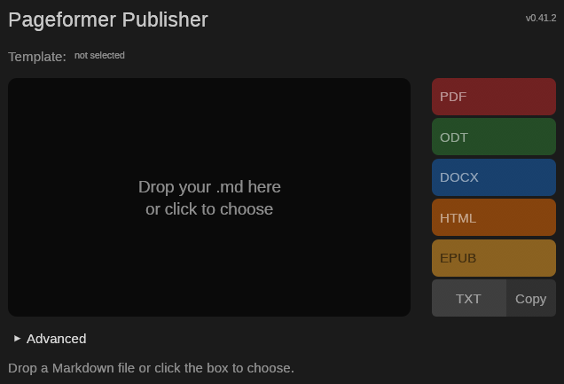

# Pageformer

*"One document, every format."*

Pageformer turns Markdown and a single YAML template into PDF, ODT, DOCX, HTML, EPUB and plain text. The same document model and the same template feed every backend, so the formats stay consistent instead of drifting apart as the project grows.

The command line is the main workflow. A small desktop window, `pageformer-publisher`, handles quick exports, and the full WYSIWYG editor, [Pageweaver](docs/pageweaver.md), is a separate project planned for after 1.0.0.

## Stack

Pageformer is written in Rust. The command line does the main work, and the minimal converter window uses egui. PDF rendering uses Typst as an internal library: users write Markdown and YAML, never Typst. Pageweaver is a separate Tauri project that consumes the same library.

## Build

The development profile keeps line tables for this crate and no debug information for dependencies. Every test binary links Typst, so dependency debug information would make the artifacts weigh hundreds of megabytes. Incremental compilation is off because its state grew to several gigabytes with little benefit in a crate this size. When the cache becomes too large, `cargo clean` reclaims it at the cost of a full rebuild.

The workspace also builds `pageformer-publisher`, the minimal egui converter. Its eframe dependencies follow the same profile. To build only the engine and the command line, use `cargo build -p pageformer`.

## Versioning

Pageformer follows SemVer. The version lives in `Cargo.toml`, under `[package].version`.

- Patch releases contain fixes and small refinements.
- Minor releases add user-facing features or output formats. While the project is 0.x, breaking changes to the template format or the document model also use the minor field.
- Major releases follow the 1.0.0 milestone and carry breaking changes to the template format or the document model.

## How a document is produced

The pipeline has a few clear stages:

1. The Markdown file is parsed into a backend-independent document model. Raw HTML and malformed input become errors, not silent omissions.
2. One YAML template is resolved for the document, validated and turned into typed styles. The nearest template wins entirely; there is no partial merge between directories.
3. Confidential `{NAME}` fields are resolved once, after parsing and before rendering, so no backend ever sees a value store.
4. The letterhead and the local images are loaded once and shared by the backends.
5. One backend renders the resolved document and template into bytes. It never reads the source file, the environment or the clock.

The details are in [`docs/architecture.md`](docs/architecture.md). The template schema is in [`docs/template.md`](docs/template.md), and the confidential folder mapping is in [`docs/confidential.md`](docs/confidential.md).

## Usage

The examples below use `cargo run --` because the crate is not published. In a built checkout, use the `pageformer` binary directly.

Render a single file next to its source, as PDF/A by default:

```sh
cargo run -- assets/examples/tecnico/Relatorio.md
```

Choose another format and write the results to another directory:

```sh
cargo run -- --format odt --output /tmp/pageformer assets/examples/tecnico/Relatorio.md
```

Validate the Markdown and the template without writing anything:

```sh
cargo run -- --check assets/examples/tecnico/Relatorio.md
```

A confidential document needs its values file and an output directory outside the source tree:

```sh
cargo run -- --confidential-file assets/examples/confidencial/embargos.ini --output assets/examples/publicacao assets/examples/escritorio/
```

### Inputs and outputs

The command accepts a file or a directory. A directory is walked recursively in path order, and only `.md` files are read. Hidden directories and `target/` are skipped, and directory symlinks are not followed, so a cycle cannot hang the run.

Without `--output`, each file is written next to its source with the extension of the chosen format. With `--output`, a directory input mirrors its relative tree under the destination, while a direct file is written flat. A file reached from more than one input is processed once, and two inputs that would write the same output are an error instead of a silent overwrite.

`--check` parses the Markdown and validates the template without writing. A failure in one file does not stop the rest of the batch, and the exit code is `1` when any input fails.

The terminal output uses color, bold and italic only when the stream is a terminal. `--color=auto` is the default and respects `NO_COLOR` and `TERM=dumb`; use `--color=always` or `--color=never` to force or disable the styling.

### Formats

| Format | Extension | Role |
|---|---|---|
| PDF | `.pdf` | Primary output. Conforms to PDF/A-2b. |
| ODT | `.odt` | Paged office format for review and editing. |
| DOCX | `.docx` | Review and exchange format for Word users. |
| HTML | `.html` | Self-contained semantic view with embedded CSS and data-URI images. |
| EPUB | `.epub` | Reflowable EPUB 3 e-book with chapters split at first-level headings. |
| TXT | `.txt` | Readable plain text for copy-as-plain-text. |

`--format` selects the output; `pdf` is the default. TXT uses UTF-8 with LF line endings, no automatic wrapping and one blank line between blocks. Headings become their text, lists keep `-` and `1.` markers, tables use tab-separated cells with a separator row, quotes are prefixed with `>` and a space, links become `label (destination)`, images become `[alt]`, footnotes are collected at the end, and an explicit page break becomes a form feed.

ODT and DOCX carry the template's page layout, fonts, headings, tables, letterhead and running header and footer. HTML keeps semantic headings, lists, tables, alerts, code blocks and endnotes, and makes no network request. EPUB splits chapters at first-level headings, generates its navigation, packages the body images and uses deterministic metadata; a frontmatter `identifier` overrides the derived UUID. TXT and the office formats ignore layout fields where the format has no equivalent, but the template is still validated, so a broken template fails the same way for every format.

### Markdown markers

A few standalone paragraphs extend ordinary CommonMark:

- `-pagebreak-` or `-!-` starts a new page.
- `-horizontal-` draws a horizontal rule, as `---`, `***` and `___` already do.
- A paragraph that contains only an image becomes a block image. The standalone lines directly below it may set `-width:...-`, `-height:...-` or `-align:left|center|right-`. One dimension is enough, because the other follows the image ratio.

The template's `formatting.image` section supplies the default alignment, the maximum width, the border, the padding and the background. A marker inside ordinary text stays ordinary text.

### Confidential fields

A `{NAME}` field in the body is a confidential field. Its value comes from a `PAGEFORMER_CONFIDENTIAL_NAME` environment variable or from an INI-style file of `NAME = value` lines passed with `--confidential-file`. Whitespace around `=` is ignored, a line whose first non-blank character is `#` or `;` is a comment, and a value keeps any `#`, `;` or further `=` after the first.

Without the flag, the document can use the user-level folder mapping described in [`docs/confidential.md`](docs/confidential.md). The file, explicit or mapped, must sit outside the source tree and, on Unix, be readable only by its owner. A document with fields must be written with `--output` to a directory outside its source tree. `--check` lists the field names without their values, and an unknown field is an error.

The committed `assets/examples/confidencial/embargos.ini` holds fictional values and must be `chmod 600` after a checkout, because Git does not preserve that mode.

### The minimal converter window

`pageformer-publisher` is a separate workspace member:

```sh
cargo run -p pageformer-publisher
```



The window is deliberately small: drop a Markdown file (or click the box to choose one), pick a format, and open the result. The Advanced section holds an optional template override, the output folder and the confidential INI file. Every label and control has a tooltip. The window calls the same pipeline as the command line and never parses, resolves or writes by itself. See [`docs/pageweaver.md`](docs/pageweaver.md) for the boundary with the editor.

## Examples

The fixtures in [`assets/examples/`](assets/examples/) exercise the parser and every backend.

- `escritorio/` holds `Contrato.md` and `Embargos.md` with the shared `.pageformer.yaml`, its fictional `Timbre.png` letterhead, a warm page background and a page-number header.
- `confidencial/embargos.ini` holds the fictional values for the fields in `Embargos.md`.
- `publicacao/` holds the generated `Contrato` and `Embargos` in PDF, ODT, DOCX, HTML, EPUB and TXT. The signature block of the contract is on its own page.
- `tecnico/Relatorio.md` has its own template and its six outputs beside it. It demonstrates a light blue page background, the running header and footer, the table style, the image frame, list markers and numbering with a nested list, an explicit page break and first-level headings that start a new page, without a letterhead. `Diagrama.png` is the block image used by the report.

All three PDFs pass veraPDF as PDF/A-2b. The ODT and DOCX packages open in LibreOffice without repair, the HTML files open offline without a network request, the EPUB packages split and navigate by their first-level headings, and the text goldens are compared byte for byte.

## Documentation

- [`docs/architecture.md`](docs/architecture.md): the pipeline, the document model, the renderer boundary and the decisions behind each backend.
- [`docs/template.md`](docs/template.md): the YAML schema, the resolution rules and every style key.
- [`docs/confidential.md`](docs/confidential.md): the confidential values file and the two-level folder mapping.
- [`docs/verification.md`](docs/verification.md): the test commands, the external validators and the example regeneration.
- [`docs/pageweaver.md`](docs/pageweaver.md): the boundary with the separate WYSIWYG editor.
- [`docs/roadmap.md`](docs/roadmap.md): what is done and what remains before 1.0.0.
