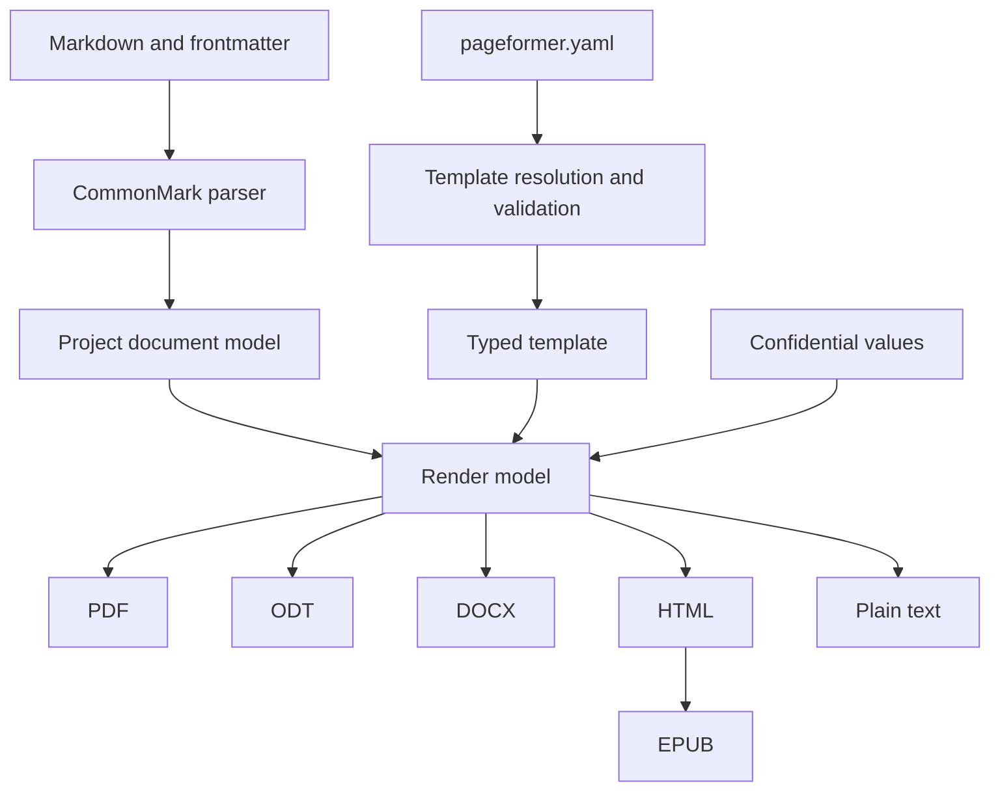

# Architecture

Pageformer turns a Markdown document plus one YAML template into several output formats. The pipeline is shared; only the last step changes.

## Document model

Markdown is parsed into a project-owned document model, not into backend-specific structures. The model holds semantic blocks and inlines, such as headings, paragraphs, lists, tables, quotes, code, images and footnotes, and carries no layout decisions. Backends read the model and never parse Markdown themselves.

The template is parsed and validated separately into a typed structure. An invalid template is fatal: the renderer never falls back to another template, because a document generated with the wrong template is worse than no document.

The Markdown subset is CommonMark plus the extensions the Zed preview renders: tables, task lists, strikethrough, footnotes, alert block quotes and YAML frontmatter. Fenced code blocks are preserved. Raw HTML is not part of the contract, so the parser rejects it instead of dropping it silently.

A paragraph that contains only `{pagebreak}` becomes `Block::PageBreak`. Braces are ordinary text to CommonMark, so the parser and the Zed preview keep the marker, and every paged backend reads the same block instead of a backend-specific string. Any other occurrence stays literal text, as does the old backslash form.

A loose ordered list whose items are one paragraph each becomes a sequence of numbered paragraphs. This keeps legal numbering such as `1.` as written, without a backslash, and without renumbering it as a list. A tight ordered list remains a list. Zed's preview still shows the loose source as a list; the document model and the generated PDF treat it as numbered paragraphs.

### Inline contract

The inline model covers every construct of that subset: text, code spans, emphasis, strong, strikethrough with single or double tildes, links (inline, reference and angle autolinks), images, soft and hard breaks, entities, escapes and footnote references. Each one has a source-generation test and a rendering test. Extensions outside the contract stay literal text: `==highlight==`, `^superscript^` and `$math$` are not enabled, because the Zed preview does not render them either. Superscript and subscript are deferred until after 1.0.0, since `~x~` is strikethrough today. Inline HTML is rejected, and smart punctuation is not enabled because it would rewrite quotes and dashes in a legal document.

## Crate layout

- `src/document.rs` holds the backend-independent model, with newtypes and smart constructors for the values the pipeline validates.
- `src/markdown.rs` parses CommonMark plus the extensions into the model. It is total: malformed event streams, raw HTML and nesting deeper than 128 levels become `MarkdownError` values.
- `src/template/` holds the versioned YAML schema and the loader that resolves which template applies.
- `src/pdf/` is the PDF backend: `source.rs` generates Typst source, `assets.rs` reads local images and the letterhead, and `world.rs` is the Typst world that serves them.
- `src/main.rs` is the CLI. It parses each input, resolves the template and either renders a PDF or reports the pipeline result.

The library is the pure core. File reading, the environment and the terminal live in the binary or in the loader's explicitly named functions.

## Consistency

Every format shares the semantic template. The current schema defines page size, orientation, margins, running header and footer content, paragraph and heading styles, weight, style, leading, spacing, inline emphasis and strong overrides, alignment, the letterhead image and table borders, header fill and cell padding.

The promise is consistency of presentation, not identical content distribution. Pagination differs between paged formats, such as PDF, and reflowable formats, such as ODT, DOCX and EPUB. The project does not try to force the same distribution. Widows and orphans must be avoided where the engine allows it. Typst already avoids them through its paragraph costs, so the template exposes no widow or orphan field until a fixture needs one.

## Template resolution

The nearest `.pageformer.yaml` wins entirely. There is no merge across directories: a local template replaces the global template and the embedded fallback. If the winning template is invalid, generation fails with a diagnostic that identifies the file, line and column.

The global template lives in the user configuration directory. A minimal fallback is embedded in the binary.

Paths inside the template, such as the letterhead image or a font file, resolve relative to the template file, not to the working directory.

## Output

Without confidential fields, the output is written next to the Markdown source, with the same name and the new extension. `--output` selects another directory, and the program creates it when missing. Writes are atomic: the bytes go to a temporary file in the destination directory and are renamed into place.

An input may be a file or a directory. A directory is walked recursively in path order; only `.md` files are read, hidden directories and `target/` are skipped, and directory symlinks are not followed. A file reached from more than one input is processed once, under the first input that found it. With `--output`, a directory input mirrors its relative tree under the destination, while a direct file is written flat. Two inputs that would write the same output are an error, never a silent overwrite.

With confidential fields, the output must be written to a directory outside the source tree, given explicitly; the program refuses to write such a document next to its sources.

## Terminal output

Results go to stdout; warnings and errors go to stderr. When the stream is a terminal, labels and paths use ANSI color, bold and italic, and results are separated by a blank line. `--color=auto` is the default and respects `NO_COLOR` and `TERM=dumb`; `--color=always` and `--color=never` force or disable it. The styling is presentation only and never changes the exit code or the generated files.

## Confidentiality

Placeholders use the form `{NAME}` in the document body, with an uppercase name such as `{NOME_COMPLETO}`. Single braces are literal text in CommonMark, so both the parser and the Zed preview keep them intact. The angle-bracket form is rejected because `<NAME>` is parsed as inline HTML.

Every token that matches `{[A-Z][A-Z0-9_]*}` is reserved for a confidential field. An unknown placeholder is a fatal error, never text left in the final document. The pattern does not apply inside code spans, code blocks, link destinations, link titles, image destinations or URLs, where the text is reproduced literally. A lowercase or spaced brace, such as `{nome}`, is ordinary text; the only exception is `{pagebreak}` alone in a paragraph, which is a page break. A substituted value is inserted once and never scanned again. A field must stay within one text run: inline formatting or a line break inside the name splits it, and the parts stay literal text.

Placeholders are resolved only in body content. One found in frontmatter metadata is an error, because confidential values must never reach the PDF XMP package, the DOCX core properties or the ODT metadata. Running header and footer slots are template content, so an uppercase token there is a template error instead of literal text.

Values come from the environment and from a file, never from a command-line argument. Environment variables use the `PAGEFORMER_CONFIDENTIAL_` prefix, such as `PAGEFORMER_CONFIDENTIAL_NOME`. The file is named with `--confidential-file`, resolves outside every source tree, and must not be readable by group or others on Unix; the file must use `chmod 600`. The file format is plain `NAME=value`, one per line, with `#` comments and blank lines ignored, no shell evaluation, a duplicate name rejected and the value kept exactly after the first `=`. The file overrides the environment.

The document model resolves the placeholders after parsing and before asset loading, and returns a new document plus the names that were found. Every backend receives only final text and never the store. A `--check` run reports the field names only. Values are redacted from warnings and errors before they reach the terminal.

Metadata comes from the frontmatter only. The template carries no document metadata, so one template serves many documents.

## Formats

- PDF is the primary output and must conform to PDF/A-2b, or PDF/A-2u when every character maps to Unicode.
- ODT is the second priority.
- DOCX follows.
- HTML, plain text and EPUB reuse the same document model. HTML is the basis for EPUB, which splits chapters at first-level headings and uses deterministic metadata.
- Plain text is a view of the model, used by the copy-as-plain-text action.

## PDF engine

The engine is Typst, used as a library. The constraint is a self-contained binary, with no Chromium, no webview and no external converter, and Typst satisfies it while providing the layout work the project would otherwise have to implement.

Typst provides pagination, headers and footers, page numbering, explicit page breaks, automatic avoidance of single-line widows and orphans, system font discovery, font subsetting and embedding, PDF/A-2b, PDF/A-2u and PDF/UA-1. The Typst language stays internal: the YAML template and the document model generate Typst content, and users never write Typst. A small `World` implementation for fonts and file access is preferred over a wrapper with an unstable API.

The crate is Apache-2.0, compatible with the project license.

### The current backend

`src/pdf` turns the model into Typst source and compiles it with the same Typst 0.15.1 library the spike used. The template sets the page dimensions, orientation, margins, letterhead, running header and footer, paragraph face, leading, spacing, alignment, one heading style per level including a page break before the level, the inline emphasis and strong styles and the table style. The frontmatter supplies the title, author, subject, keywords, language and date. The date defaults to 2026-01-01, and the world reports the same date, so the same input produces the same bytes.

User text is escaped for Typst markup (`\`, `#`, `$`, `*`, `_`, `` ` ``, brackets, angle brackets, `@`, `~`, `-`, `+`, `/`, `=`, `:`, `&`, braces and periods; the period keeps `1.` from becoming an enum marker). Strings passed to Typst functions are escaped for Typst string literals. Local images are read at the edge, stored under a synthetic project path and served by the world; remote images are rejected. The letterhead resolves against the template file and the images resolve against the Markdown file.

Embedded fonts are loaded before system fonts, so Libertinus Serif is always available as the last family in the default list. This keeps the binary self-contained, while a template can still prefer system fonts.

Running header and footer slots expand the lowercase tokens `{page}`, `{pages}`, `{title}` and `{author}`; any other lowercase token is a template error, and an uppercase confidential field is a template error too. The backend emits an explicit heading rule for each level, applies the inline emphasis and strong faces, uses Typst's default list styles, draws the configured table grid and header fill and emits `#pagebreak()` for a page-break block.

### Spike results

The first spike (Typst 0.15.1, Rust 1.99.1, release profile with thin LTO and stripped symbols) rendered a nine-page A4 contract with system fonts, a header, a footer with page numbers, a table and signature lines.

| Measurement | Result |
|---|---|
| Binary size | 40,387,192 bytes (about 38.5 MiB) |
| Clean build | 62.6 s, peak RSS about 1.9 GiB |
| Runtime | about 0.17 s, peak RSS about 33 MiB |
| Output | 73,781 bytes, PDF 1.7, nine A4 pages, tagged |
| Fonts | Liberation Serif regular, bold and italic, embedded and subsetted |
| PDF/A-2b | PASS with veraPDF 1.31.207 |

The document date is fixed to 2026-01-01 UTC, so the output was deterministic: two runs and a clean rebuild produced the same SHA-256. The spike was removed when the real crate layout replaced it. The current backend reuses the same engine and fixes the date the same way; the measurements above remain the reference for build, binary size and runtime, but were not re-run for the backend.

The AST-to-Typst layer escapes user text before emitting Typst: `$` opens math, `*` and `_` mark emphasis, `#` starts code, and brackets open content blocks. PDF/A also requires a document date, so the generator sets one explicitly. See "The current backend" above for the implemented escaping and date policy.

krilla remains the fallback. It is a high-level PDF writer with PDF/A and PDF/UA support, but it explicitly leaves text layout, tables, page breaking and headers to the caller; choosing it would mean implementing those algorithms in the project.

PDF/A output is validated with veraPDF, because producing a valid PDF/A file is not the same as conforming to the profile. All example PDFs pass veraPDF 1.30.3 as PDF/A-2b; the test suite checks the PDF header, the PDF/A markers and deterministic bytes, and leaves the full veraPDF run to the verification commands in `docs/verification.md`.

The backend declares PDF/A-2b. PDF/A-2u was evaluated and is not emitted: when the file declares B, veraPDF reports only the conformance-identifier rule for 2u, so the stronger level would change the declaration without a user need. PDF/UA-1 stays out until accessibility becomes a requirement.

## Testing

Pure tests cover the document model, the Markdown parser, template validation, template resolution and the Typst source generation. The fixtures in `assets/examples/` drive the parser and PDF tests. The office examples live in `escritorio/`, their fictional values in `confidencial/`, and the generated PDFs in `publicacao/`. HTML and plain text will be compared as text once those backends exist. ZIP-based formats will be checked structurally. PDF output is checked for the PDF header and the PDF/A markers, and the same input must produce identical bytes in two runs. A corpus of real documents is kept as fixtures, because typography regressions do not appear in synthetic samples.

The parser also has property tests that assert arbitrary text is either accepted or rejected without panicking. The template parser has the same property.

The fixtures are in `assets/examples/`: `escritorio/Contrato.md` and `escritorio/Embargos.md` with the shared `.pageformer.yaml` and its `Timbre.png` letterhead, plus `tecnico/Relatorio.md` with its own template. The office PDFs are generated into `publicacao/`, using `confidencial/embargos.env` for the fields in the embargos. The PDFs are outputs of the current backend, not byte targets; all three pass veraPDF as PDF/A-2b.

## Editor support

The document syntax stays plain Markdown so the Zed preview renders it without a plugin. Zed highlights standard Markdown constructs and injects languages into code fences, but it has no rule for the project's `{pagebreak}` or `{NOME}` tokens. No widely adopted free Markdown extension closes that gap: Pandoc and markdown-it containers (`::: pagebreak`) and CriticMarkup annotations (`{>> ... <<}`) are not highlighted by Zed either, and HTML comments would only suit block markers, not inline confidential fields. The tokens stay plain text in the editor; highlighting would need a dedicated Zed language extension with its own file type, or an upstream grammar change. Correctness never depends on an editor feature.

## Open decisions

- ODT implementation: a native ODF writer or another path.
- DOCX library choice and the shared document model for reflowable formats.
