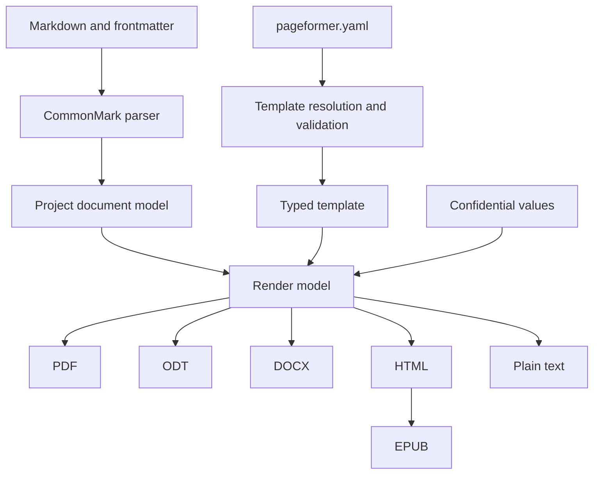

# Architecture

Pageformer turns a Markdown document plus one YAML template into several output formats. The pipeline is shared; only the last step changes.

## Document model

Markdown is parsed into a project-owned document model, not into backend-specific structures. The model holds semantic blocks and inlines, such as headings, paragraphs, images, lists, tables, quotes, code and footnotes, and carries no backend layout decisions. A standalone image becomes an image block with its requested size and optional alignment; an image inside a paragraph stays an inline image. Backends read the model and never parse Markdown themselves.

The template is parsed and validated separately into a typed structure. An invalid template is fatal: the renderer never falls back to another template, because a document generated with the wrong template is worse than no document.

The Markdown subset is CommonMark plus the extensions the Zed preview renders: tables, task lists, strikethrough, footnotes, alert block quotes and YAML frontmatter. Fenced code blocks are preserved. Raw HTML is not part of the contract, so the parser rejects it instead of dropping it silently.

A paragraph that contains only `-pagebreak-` or `-!-` becomes `Block::PageBreak`. The markers are ordinary text to CommonMark, so the parser and the Zed preview keep them, and every paged backend reads the same block instead of a backend-specific string. A paragraph that contains only `-horizontal-` becomes `Block::ThematicBreak`, alongside the standard `---`, `***` and `___`. Any other occurrence stays literal text, as do the old `{pagebreak}` and backslash forms.

A loose ordered list whose items are one paragraph each becomes a sequence of numbered paragraphs. This keeps legal numbering such as `1.` as written, without a backslash, and without renumbering it as a list. A tight ordered list remains a list. Zed's preview still shows the loose source as a list; the document model and the generated PDF treat it as numbered paragraphs.

CommonMark ordered lists use numeric markers only. A line typed as `a.`, `i.` or `IV.` is ordinary text, and consecutive lines without blank lines merge under the soft-break rule; the template formats real ordered lists by nesting depth instead.

### Inline contract

The inline model covers every construct of that subset: text, code spans, emphasis, strong, strikethrough with single or double tildes, links (inline, reference and angle autolinks), images, soft and hard breaks, entities, escapes and footnote references. A standalone image paragraph and its `-width-`, `-height-` and `-align-` markers become an image block; a marker line in ordinary text stays text. Each one has a source-generation test and a rendering test. Extensions outside the contract stay literal text: `==highlight==`, `^superscript^` and `$math$` are not enabled, because the Zed preview does not render them either. Superscript and subscript are deferred until after 1.0.0, since `~x~` is strikethrough today. Inline HTML is rejected, and smart punctuation is not enabled because it would rewrite quotes and dashes in a legal document.

## Crate layout

- `src/document.rs` holds the backend-independent model, with newtypes and smart constructors for the values the pipeline validates.
- `src/markdown.rs` parses CommonMark plus the extensions into the model. It is total: malformed event streams, raw HTML and nesting deeper than 128 levels become `MarkdownError` values.
- `src/render.rs` holds the renderer boundary: the `Renderer` trait and the backend-neutral `Rendered` value.
- `src/assets.rs` resolves the letterhead and the local images once, so every backend receives the same bytes without reading files itself.
- `src/template/` holds the versioned YAML schema and the loader that resolves which template applies.
- `src/pdf/` is the PDF backend: `source.rs` generates Typst source and `world.rs` is the Typst world that serves the fonts and assets.
- `src/txt.rs` is the plain-text backend. It needs no assets and cannot fail.
- `src/odt/` is the ODT backend: `content.rs`, `styles.rs` and `meta.rs` generate the XML parts, and `src/zip.rs` builds the deterministic stored ZIP package.
- `src/docx/` is the DOCX backend: `content.rs`, `styles.rs`, `numbering.rs` and `package.rs` generate the OOXML parts, reusing the same ZIP and metrics.
- `src/html/` is the HTML backend: `content.rs` maps the model, `css.rs` derives the stylesheet, `escape.rs` escapes text and attributes and `data_uri.rs` embeds the images.
- `src/epub/` is the EPUB backend: `chapters.rs` splits at first-level headings and `package.rs` writes the XHTML, navigation, OPF, CSS and deterministic ZIP.
- `src/xml.rs`, `src/metrics.rs` and `src/image.rs` hold the XML escaping, the Typst spacing model and the intrinsic image sizes shared by the office backends.
- `src/main.rs` is the CLI. It parses each input, resolves the template and either renders the chosen format or reports the pipeline result.

The library is the pure core. File reading, the environment and the terminal live in the binary or in the loader's explicitly named functions.

## Consistency

Colors accept `#rrggbb`, `#rgb` and the 148 CSS named colors, resolved to an RGB triple when the template loads, so every backend reads the same numeric value and never a name.

Every format shares the semantic template. The current schema defines page size, orientation, margins, page background, running header and footer content, paragraph and heading styles, a body fill, heading backgrounds and rules that the base map can carry and a level can clear with `none`, the thematic break, weight, style, text color, leading, spacing, inline emphasis, strong, code, strikethrough and link overrides, quote and code block styles, which inherit the body face, with alignment and per-side borders, an image style with alignment, maximum width, border, padding and background, list styles with indent, marker gap, bullets, numbering formats and item spacing, task marker strings, spacing and their own text overrides, alignment, the letterhead image and, under `formatting.table`, the table borders, header fill and cell padding. A link inherits the paragraph face, while its color, fill and underline stay declared-only, like every other inline style. A task marker stores only its declared keys and inherits the list item face and color.

Blocks are left aligned by default, because justified quotes and code read worse; `alignment: justified` restores the body behaviour. A block border declares each side separately and puts the padding only on the sides that have a rule.

A body fill belongs to body paragraphs only. Each format applies it through a body paragraph style, so a quote, a list item or a table cell keeps the background its own style declares, and an inline background fills the span itself.

The promise is consistency of presentation, not identical content distribution. Pagination differs between paged formats, such as PDF, and reflowable formats, such as ODT, DOCX and EPUB. The project does not try to force the same distribution. Widows and orphans must be avoided where the engine allows it. Typst already avoids them through its paragraph costs, so the template exposes no widow or orphan field until a fixture needs one.

## Template resolution

The nearest `.pageformer.yaml` wins entirely. There is no merge across directories: a local template replaces the global template and the embedded fallback. If the winning template is invalid, generation fails with a diagnostic that identifies the file, line and column.

The global template lives in the user configuration directory. A minimal fallback is embedded in the binary.

Paths inside the template, such as the letterhead image or a font file, resolve relative to the template file, not to the working directory.

## Output

Without confidential fields, the output is written next to the Markdown source, with the same name and the extension of the chosen format. `--output` selects another directory, and the program creates it when missing. Writes are atomic: the bytes go to a temporary file in the destination directory and are renamed into place.

An input may be a file or a directory. A directory is walked recursively in path order; only `.md` files are read, hidden directories and `target/` are skipped, and directory symlinks are not followed. A file reached from more than one input is processed once, under the first input that found it. With `--output`, a directory input mirrors its relative tree under the destination, while a direct file is written flat. Two inputs that would write the same output are an error, never a silent overwrite.

With confidential fields, the output must be written to a directory outside the source tree, given explicitly; the program refuses to write such a document next to its sources.

## Terminal output

Results go to stdout; warnings and errors go to stderr. When the stream is a terminal, labels and paths use ANSI color, bold and italic, and results are separated by a blank line. `--color=auto` is the default and respects `NO_COLOR` and `TERM=dumb`; `--color=always` and `--color=never` force or disable it. The styling is presentation only and never changes the exit code or the generated files.

## Confidentiality

Placeholders use the form `{NAME}` in the document body, with an uppercase name such as `{NOME_COMPLETO}`. Single braces are literal text in CommonMark, so both the parser and the Zed preview keep them intact. The angle-bracket form is rejected because `<NAME>` is parsed as inline HTML.

Every token that matches `{[A-Z][A-Z0-9_]*}` is reserved for a confidential field. An unknown placeholder is a fatal error, never text left in the final document. The pattern does not apply inside code spans, code blocks, link destinations, link titles, image destinations or URLs, where the text is reproduced literally. A lowercase or spaced brace, such as `{nome}`, is ordinary text. A substituted value is inserted once and never scanned again. A field must stay within one text run: inline formatting or a line break inside the name splits it, and the parts stay literal text.

Placeholders are resolved only in body content. One found in frontmatter metadata is an error, because confidential values must never reach the PDF XMP package, the DOCX core properties or the ODT metadata. Running header and footer slots are template content, so an uppercase token there is a template error instead of literal text.

Values come from the environment and from a file, never from a command-line argument. Environment variables use the `PAGEFORMER_CONFIDENTIAL_` prefix, such as `PAGEFORMER_CONFIDENTIAL_NOME`. The file is named with `--confidential-file`, resolves outside every source tree, and must not be readable by group or others on Unix; the file must use `chmod 600`. The file format is INI-style: one `NAME = value` per line, with whitespace around the name, the `=` and the value trimmed, lines whose first non-blank character is `#` or `;` treated as comments and blank lines ignored. A value keeps every `=` after the first one and any `#` or `;` that does not start the line. Sections, quotes, escapes, shell evaluation and interpolation are not part of the format. A duplicate name is rejected, and the file overrides the environment. Using INI instead of Markdown or YAML also keeps the values file outside the editorial sources, so the editor `private_files` (global) and `private_paths` (worktree) settings can refuse it to the assistant's file reads; the guarantee does not depend on the editor, because the file already lives outside the source tree and is never printed.

The document model resolves the placeholders after parsing and before asset loading, and returns a new document plus the names that were found. Every backend receives only final text and never the store. A `--check` run reports the field names only. Values are redacted from warnings and errors before they reach the terminal.

Metadata comes from the frontmatter only. The template carries no document metadata, so one template serves many documents.

## Renderer boundary

Every format implements `Renderer`: the pipeline resolves the document, the template and the assets the backend needs, then calls `render`, which returns bytes plus warnings. The trait is deliberately small so the minimal GUI and the separate editor, Pageweaver, can call the same function as the command line, and `render` never reads a file, the environment or the clock. Asset loading is a separate, explicitly named step because the policy differs per format: PDF, ODT, DOCX and HTML read images and the letterhead, while plain text reads no assets at all. Pageweaver exports through this library and never reimplements the pipeline; see [`pageweaver.md`](pageweaver.md). The effectful edge is `src/pipeline.rs`: `DocumentJob` and `Source`, `resolve_template`, `check`, `render` and `export`; the CLI, `pageformer-publisher` and Pageweaver call them. The window itself is `publisher/`, a separate workspace member.

## Plain text

Plain text is a view of the model, used by the copy-as-plain-text action. The output is UTF-8 with LF line endings, no automatic wrapping and one blank line between blocks; the renderer appends one final newline unless the document is empty. Headings become their text. Lists keep `-` and `1.` markers, nested items are indented under the parent marker, and task items keep `[ ]` and `[x]` regardless of the template markers; a numbered paragraph keeps its number. Tables are tab-separated cells with a `---` separator row, quotes prefix every line with `>` and a space, and a blank quote line with `>` alone, code blocks are preserved, links become `label (destination)`, images become `[alt]`, footnote references stay as `[^id]` and the definitions are collected at the end, soft breaks become spaces and hard breaks become newlines. A thematic break is `---` and an explicit page break becomes a form feed. Layout fields are ignored, but the template is resolved and validated first, so a broken template fails the same way in every format.

## Formats

- PDF is the primary output and must conform to PDF/A-2b, or PDF/A-2u when every character maps to Unicode.
- ODT is the paged format for office review and is implemented with the internal writer below.
- DOCX is the review and exchange format and is implemented with the internal OOXML writer below.
- Plain text is implemented and carries the copy-as-plain-text view.
- HTML is implemented as one self-contained semantic file with embedded CSS and data-URI images.
- EPUB is implemented as an EPUB 3 package that reuses the HTML block and inline conversion, splits chapters at first-level headings and uses deterministic metadata.

## ODT writer

ODT uses an internal ODF writer instead of a full ODT library, because the template fields map to a small, known set of styles and the package must be deterministic. The ZIP container is written by `src/zip.rs` with stored entries and a fixed timestamp, so no compression crate is needed and two runs produce identical bytes. The order is fixed: `mimetype` first and uncompressed, then `META-INF/manifest.xml`, `content.xml`, `styles.xml`, `meta.xml` and the pictures.

The template maps to named styles for the paragraph face, leading, spacing and alignment, to character styles for emphasis, strong, strikethrough, code and links, to one heading style per level with its spacing, optional page break, background and rule, to list styles whose level data carries the indent, gap, bullets, numbering and suffix, to a marker-free `TaskList` style when the template hides the bullet of a task-only list, to the `TaskDone` and `TaskTodo` character styles, and to table, thematic break and page styles. The page layout carries the size, orientation, margins and page fill, the letterhead as a stretched page background, and the running header and footer, whose `{page}` and `{pages}` tokens become page fields while `{title}` and `{author}` expand from the frontmatter.

The body maps blocks and inlines to ODF content: paragraphs, headings with outline levels, lists with their start value, task markers as `TaskDone` or `TaskTodo` spans followed by non-breaking spaces, tables with a header row and cell alignment, quotes with a visible `[!KIND]` label for alerts, preserved code, links with the `Link` character style, footnotes as inline notes whose definitions are collected, with the citation in the `Footnote anchor` and `Footnote Symbol` styles so both the reference and the note body are superscript, and images under `Pictures/`. An inline image keeps its intrinsic size capped to the text width. A block image uses a `draw:frame` in a generated left, center or right paragraph; `ImageFrame` carries the declared padding and fill, and a uniform four-side border becomes `draw:stroke`, because LibreOffice does not paint `fo:border` on a graphic frame. A partial border still uses `fo:border-*`. The frame size comes from the shared image layout. Numbered paragraphs keep their literal number. List items take `ListItem` or `ListLooseItem`, so the face, color, fill and alignment apply to the first paragraph, and the tight style drops the margin. Spacing follows the Typst model rather than the ODF defaults: Typst advances a line by the leading plus the font's cap height, so the ODF line height uses that sum (the cap height is approximated by 0.657 of the size), and the paragraph margin is the template spacing minus the leading. Heading margins are trimmed by the line box Writer adds. Headings use the font's natural line height, `fo:line-height="100%"`, instead of the calibrated sum, because a heading fill has to scale with the heading size the way the DOCX fill does; the body keeps the sum so its line breaks stay close to the PDF. A table cell uses the same line advance, but the leading is moved into the vertical padding, because Typst cells hold inline content rather than a paragraph; the row height then matches the PDF. The last item of a tight list keeps the paragraph margin, so the list still separates from the next block. Hyphenation is enabled on paragraphs, headings and cells with the frontmatter language, because Typst hyphenates and the line breaks otherwise drift far enough to move a paragraph to the next page. A running header or footer uses the paragraph face and reserves a 1.5cm band from the page margin, so the body keeps the template margins and the header sits in the letterhead band instead of pushing the text. A heading background in ODT also covers the padding above the rule, because the padding sits inside the paragraph background; the PDF keeps the fill to the text. Metadata carries the title, author, language, subject, keywords and generator, and never a body value.

## DOCX writer

DOCX uses an internal OOXML writer that reuses the deterministic ZIP and the shared metrics; a full library would add a large dependency and still leave the style and determinism decisions open. The fixed parts are `[Content_Types].xml`, `_rels/.rels`, `docProps/core.xml`, `docProps/app.xml`, `word/document.xml` with its relationships, `word/styles.xml`, `word/numbering.xml`, `word/footnotes.xml`, `word/settings.xml`, an optional header and footer, and the media under `word/media/`. Relationship ids, numbering ids, drawing ids and the core property dates are fixed, so two runs are byte-identical.

Every list gets its own numbering instance, and an ordered list that does not start at one carries a start override, so legal numbering restarts where the source says. The abstract numbering levels carry the template bullets, numbering format, suffix, indent, gap and marker run properties, and the item paragraph uses `ListParagraph` for the face, color, fill, alignment and spacing. A task-only unordered list with the bullet hidden uses a third abstract numbering with `w:numFmt` `none`, no level text and no hanging indent; the `TaskDone` and `TaskTodo` character styles carry the declared marker overrides. Table header rows repeat through `w:tblHeader`, the template supplies the borders, the header fill and the cell padding, and the Markdown alignment sets the cell alignment. Heading backgrounds become paragraph shading, a heading rule becomes the bottom border of its style with the gap as the border spacing, text colors become `w:color` on the default style, on the heading styles and on the emphasis, strong and link runs, and the thematic break becomes a bottom paragraph border with the template thickness, color and spacing. Links carry the generated `Hyperlink` character style, including the template color, fill and optional underline. A page fill becomes `w:background` before the body plus `w:displayBackgroundShape` in the settings. A framed block image becomes a one-cell table: the table border draws the frame, the cell margins provide the padding, the cell shading provides the fill, `w:jc` aligns the table and the image keeps its resolved size. The grid and cell widths include both side paddings, so the image never reaches the border. An image without a frame stays in a centered paragraph. The running header and footer use tab stops for the three slots, `PAGE` and `NUMPAGES` fields for the page tokens, and the letterhead as a floating image anchored to the page behind the text. Footnotes are inline note references with collected bodies. Metadata carries the title, author, subject, keywords and language, and never a body value.

Word hyphenates only when the reader enables it: automatic hyphenation is left out of the package, because enabling it in the settings made LibreOffice ask for a dictionary even when the system package was installed. The document language is still written in the styles, so the editor uses the right spelling and can turn hyphenation on. Line breaks can therefore differ slightly from the PDF.

## HTML writer

HTML is one file with no network request: the stylesheet sits in a `<style>` element and every image, including the letterhead, becomes a data URI. The markup is HTML5 serialized so an XML parser can read it, which keeps the structural tests on the existing `roxmltree` dependency and lets the EPUB backend reuse the same block and inline conversion. Text and attributes are escaped once at the boundary; template strings that reach CSS, such as font names, bullets, suffixes and running content, pass through a CSS string escaper that also prevents a value from closing the style element or the CDATA section.

The body follows the model: headings, body paragraphs, numbered paragraphs, lists with their start value and depth, task markers, tables with a `thead`, quotes and alerts, fenced code with a language class, thematic breaks and page breaks. A list fill belongs to the first paragraph of the item, not to the whole `li`, so it starts at the item indentation and does not paint a nested list; the task marker stays inside the filled paragraph. An empty table cell receives a non-breaking line box through `:empty::after`, so a signature grid keeps the row height of the other formats. Footnotes are collected in a `section` with `role="doc-endnotes"`, numbered in first-reference order and linked with backlinks; an unreferenced definition is not emitted, matching the paged formats. A footnote reference without a definition stays literal text and produces a warning.

The stylesheet derives the page size, orientation, margins and background, the paragraph face, leading, spacing and alignment, the inline styles, every heading level, the horizontal rule, quote and code blocks, the block image figure and frame, lists and task markers, the table grid and the footnote separator from the template. On screen the document sits in a page-like container with the template width and padding; it does not fake pagination. In print, `@page` carries the size, margins and background color, explicit page breaks become `break-after: page` and `page_break_before` becomes `break-before: page`; the browser decides the pagination. The page background also paints the screen page container and the print canvas, so it does not depend on `@page` background support.

A block image is a `figure.image-block` with an inner `span.image-frame`; the figure carries the alignment through `text-align`, and the span carries the width, maximum width, border, padding and fill, so the frame hugs the image instead of the full column. The image fills the frame with `width: 100%`; the percentage belongs to the frame, not to the image. The letterhead is print-only, as a page background, because the fixture is a full A4 image that would be a distorted banner on screen. The running header and footer are print-only `@page` margin boxes: `{page}` and `{pages}` become `counter(page)` and `counter(pages)`, while `{title}` and `{author}` come from the frontmatter. Browsers that do not implement page backgrounds or margin boxes simply omit them; the HTML remains valid and offline. The screen view has no running content, so it never displays a page number the document cannot know.

Links allow relative destinations and the `http`, `https` and `mailto` schemes. Any other scheme, including `javascript:`, `data:`, `file:` and `vbscript:`, is rendered as plain text with a warning and never reaches `href`. Images are local assets loaded by the pipeline and embedded as data URIs; a missing asset falls back to the alternative text and a warning. The output has no script and no external resource.

The output is deterministic: attributes and CSS rules have a fixed order, notes follow reference order and assets follow a `BTreeMap`. It carries no generator or version, so a patch release does not change the HTML examples. `html::stylesheet` exposes the generated screen and structural print CSS for the Pageweaver preview, which consumes the same class names instead of reparsing the template.

## EPUB writer

EPUB 3 packages the HTML content without a second converter. `src/epub/chapters.rs` splits the top-level blocks at each first-level heading; content before the first heading becomes an introduction, a document without a first-level heading stays one chapter, and a chapter whose rendered body is empty is dropped. Each chapter receives all footnote definitions from the document, so a reference resolves even when its definition is in another chapter. Footnotes stay per chapter: numbering restarts and the links stay local.

The body uses `src/html/content.rs` with a relative image source instead of a data URI. Body images are loaded separately from the letterhead by `assets::load_images`, packaged under `OEBPS/images/` and referenced from the chapters. Block images keep the same figure and frame classes, and their absolute width is capped by the reader viewport. The letterhead, the running header and footer, the page size and the margins are omitted because EPUB is reflowable. The page background, when declared, becomes the `html` and `body` fill; the reader still owns the text column and its margins. explicit page breaks are hidden by the EPUB CSS. `src/html/css.rs` exposes a reflowable subset with the body face, line height, alignment, headings, lists, tables, quotes, code and notes, while the HTML backend keeps its screen and print stylesheets byte-identical.

The package order is `mimetype` first and stored, then `META-INF/container.xml`, `OEBPS/content.opf`, `OEBPS/nav.xhtml`, `OEBPS/style.css`, the chapters and the images. The OPF carries `dc:identifier`, `dc:title`, `dc:language`, the optional creator, date and subjects, and a deterministic `dcterms:modified`. The navigation is an EPUB 3 `nav` with `epub:type="toc"`; there is no NCX. `src/zip.rs` supplies the fixed timestamp and stored entries, so two renders are byte-identical.

The frontmatter `identifier` becomes `dc:identifier`. Without it, the identifier is a UUID v5 over the metadata and the rendered chapter bodies, with the standard URL namespace; CSS, the source path and the clock stay out of the hash. The title falls back to the first first-level heading and then to `Untitled`, and a missing language becomes `und`. The EPUB is not page-perfect: the reader chooses the pagination and the fonts.

## PDF engine

The engine is Typst, used as a library. The constraint is a self-contained binary, with no Chromium, no webview and no external converter, and Typst satisfies it while providing the layout work the project would otherwise have to implement.

Typst provides pagination, headers and footers, page numbering, explicit page breaks, automatic avoidance of single-line widows and orphans, system font discovery, font subsetting and embedding, PDF/A-2b, PDF/A-2u and PDF/UA-1. The Typst language stays internal: the YAML template and the document model generate Typst content, and users never write Typst. A small `World` implementation for fonts and file access is preferred over a wrapper with an unstable API.

The crate is Apache-2.0, compatible with the project license.

### The current backend

`src/pdf` turns the model into Typst source and compiles it with the same Typst 0.15.1 library the spike used. The template sets the page dimensions, orientation, margins, page fill, letterhead, running header and footer, the block image alignment, maximum width, border, padding and fill, paragraph face, leading, spacing, alignment, one heading style per level including a page break before the level, the heading backgrounds and rules, the inline emphasis and strong styles, the list markers, numbering, indent, gap, face and fill, the task markers as inline `#text`/`#box` content, the thematic break and the table style. A task-only list with the bullet hidden passes an empty marker and zero body indent to the list. A heading background is a full-width block with a vertical padding of 0.24 of the heading size, so the fill does not hug the glyphs, and the rule sits below the fill. The DOCX fill, which covers the font's line box, is the reference: at the 18pt heading the PDF band measures 21.1pt against 20.6pt, and at 14pt both measure 16.3pt. The frontmatter supplies the title, author, subject, keywords, language and date. The date defaults to 2026-01-01, and the world reports the same date, so the same input produces the same bytes.

User text is escaped for Typst markup (`\`, `#`, `$`, `*`, `_`, `` ` ``, brackets, angle brackets, `@`, `~`, `-`, `+`, `/`, `=`, `:`, `&`, braces and periods; the period keeps `1.` from becoming an enum marker). Strings passed to Typst functions are escaped for Typst string literals. Local images are read at the edge, stored under a synthetic project path and served by the world; remote images are rejected. The letterhead resolves against the template file and the images resolve against the Markdown file.

Embedded fonts are loaded before system fonts, so Libertinus Serif is always available as the last family in the default list. This keeps the binary self-contained, while a template can still prefer system fonts.

Running header and footer slots expand the lowercase tokens `{page}`, `{pages}`, `{title}` and `{author}`; any other lowercase token is a template error, and an uppercase confidential field is a template error too. The backend emits an explicit heading rule for each level, applies the inline emphasis and strong faces, sets the list marker, numbering, indent and gap from the template, styles and places the task markers, draws the configured table grid and header fill and emits `#pagebreak()` for a page-break block.

### Spike results

The first spike (Typst 0.15.1, Rust 1.99.1, release profile with thin LTO and stripped symbols) rendered a nine-page A4 contract with system fonts, a header, a footer with page numbers, a table and signature lines.

| Measurement | Result |
|---|---|
| Binary size | 40,387,192 bytes (about 38.5 MiB) |
| Clean build | 62.6 s, peak RSS about 1.9 GiB |
| Runtime | about 0.17 s, peak RSS about 33 MiB |
| Output | 73,781 bytes, PDF 1.7, nine A4 pages, tagged |
| Fonts | Liberation Serif regular, bold and italic, embedded and subsetted |
| PDF/A-2b | PASS with veraPDF 1.31.207 |

The document date is fixed to 2026-01-01 UTC, so the output was deterministic: two runs and a clean rebuild produced the same SHA-256. The spike was removed when the real crate layout replaced it. The current backend reuses the same engine and fixes the date the same way; the measurements above remain the reference for build, binary size and runtime, but were not re-run for the backend.

The AST-to-Typst layer escapes user text before emitting Typst: `$` opens math, `*` and `_` mark emphasis, `#` starts code, and brackets open content blocks. PDF/A also requires a document date, so the generator sets one explicitly. See "The current backend" above for the implemented escaping and date policy.

krilla remains the fallback. It is a high-level PDF writer with PDF/A and PDF/UA support, but it explicitly leaves text layout, tables, page breaking and headers to the caller; choosing it would mean implementing those algorithms in the project.

PDF/A output is validated with veraPDF, because producing a valid PDF/A file is not the same as conforming to the profile. All example PDFs pass veraPDF 1.30.3 as PDF/A-2b; the test suite checks the PDF header, the PDF/A markers and deterministic bytes, and leaves the full veraPDF run to the verification commands in `docs/verification.md`.

The backend declares PDF/A-2b. PDF/A-2u was evaluated and is not emitted: when the file declares B, veraPDF reports only the conformance-identifier rule for 2u, so the stronger level would change the declaration without a user need. PDF/UA-1 stays out until accessibility becomes a requirement.

## Testing

Pure tests cover the document model, the Markdown parser, template validation, template resolution and the Typst source generation. The fixtures in `assets/examples/` drive the parser and PDF tests. The office examples live in `escritorio/`, their fictional values in `confidencial/`, and the generated formats in `publicacao/`. HTML is compared structurally and by normalized text; plain text has byte goldens. The ZIP-based formats are checked structurally, and the EPUB package also checks the manifest, navigation, chapter split and deterministic identifier. PDF output is checked for the PDF header and the PDF/A markers, and the same input must produce identical bytes in two runs. A corpus of real documents is kept as fixtures, because typography regressions do not appear in synthetic samples.

The parser also has property tests that assert arbitrary text is either accepted or rejected without panicking. The template parser has the same property.

The fixtures are in `assets/examples/`: `escritorio/Contrato.md` and `escritorio/Embargos.md` with the shared `.pageformer.yaml` and its `Timbre.png` letterhead, plus `tecnico/Relatorio.md` with its own template. The office PDFs are generated into `publicacao/`, using `confidencial/embargos.ini` for the fields in the embargos. The PDFs are outputs of the current backend, not byte targets; all three pass veraPDF as PDF/A-2b.

## Editor support

The document syntax stays plain Markdown so the Zed preview renders it without a plugin. Zed highlights standard Markdown constructs and injects languages into code fences, but it has no rule for the project's `-pagebreak-`, `-!-`, `-horizontal-` or `{NOME}` tokens. No widely adopted free Markdown extension closes that gap: Pandoc and markdown-it containers (`::: pagebreak`) and CriticMarkup annotations (`{>> ... <<}`) are not highlighted by Zed either, and HTML comments would only suit block markers, not inline confidential fields. The tokens stay plain text in the editor; highlighting would need a dedicated Zed language extension with its own file type, or an upstream grammar change. Correctness never depends on an editor feature.

## Open decisions

- ODT implementation: a native ODF writer or another path.
- DOCX library choice and the shared document model for reflowable formats.
