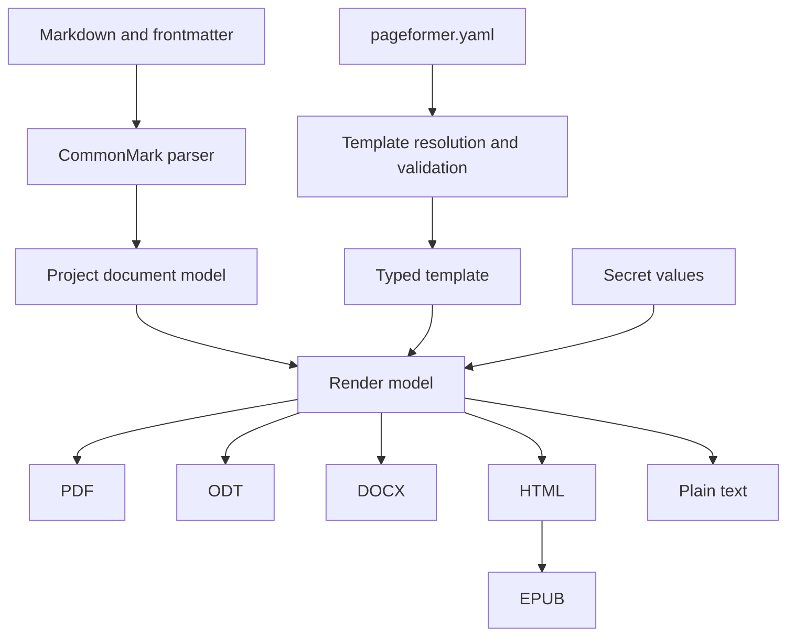

# Architecture

Pageformer turns a Markdown document plus one YAML template into several output formats. The pipeline is shared; only the last step changes.

## Document model

Markdown is parsed into a project-owned document model, not into backend-specific structures. The model holds semantic blocks and inlines, such as headings, paragraphs, lists, tables, quotes, code, images and explicit page breaks, and carries no layout decisions. Backends read the model and never parse Markdown themselves.

The template is parsed and validated separately into a typed structure. An invalid template is fatal: the renderer never falls back to another template, because a document generated with the wrong template is worse than no document.

The Markdown subset is CommonMark plus the extensions the Zed preview renders: tables, task lists, strikethrough, footnotes, alert block quotes and YAML frontmatter. Fenced code blocks are preserved. Raw HTML is not part of the contract.

## Consistency

Every format shares the semantic template: page size, orientation, margins, fonts, colors, line spacing, heading styles, header and footer content and the letterhead image.

The promise is consistency of presentation, not identical content distribution. Pagination differs between paged formats, such as PDF, and reflowable formats, such as ODT, DOCX and EPUB. The project does not try to force the same distribution. Widows and orphans must be avoided where the engine allows it.

## Template resolution

The nearest `.pageformer.yaml` wins entirely. There is no merge across directories: a local template replaces the global template and the embedded fallback. If the winning template is invalid, generation fails with a diagnostic that identifies the file, line and column.

The global template lives in the user configuration directory. A minimal fallback is embedded in the binary.

Paths inside the template, such as the letterhead image or a font file, resolve relative to the template file, not to the working directory.

## Output

Without secrets, the output is written next to the Markdown source, with the same name and the new extension. With secrets, the output must be written to a directory outside the source tree, given explicitly; the program refuses to write a secret-bearing document next to its sources. Writes are atomic.

## Secrets

Placeholders use the form `{{NAME}}` in the document body. The angle-bracket form is avoided because CommonMark parses `<NAME>` as inline HTML, so both the parser and the editor preview would treat it as markup.

Secret values are loaded from a file outside the source tree, or from the environment, and are never accepted as command-line arguments. They are redacted from debug output and error messages and never printed to the console. A `--check` run reports placeholder names only.

Secret values are never written to document metadata, including the PDF XMP package, the DOCX core properties or the ODT metadata. Metadata comes from the template and the frontmatter only.

The document model replaces placeholders at render time, after parsing and before a backend sees the content.

## Formats

- PDF is the primary output and must conform to PDF/A-2b, or PDF/A-2u when every character maps to Unicode.
- ODT is the second priority.
- DOCX follows.
- HTML, plain text and EPUB reuse the same document model. HTML is the basis for EPUB, which splits chapters at first-level headings and uses deterministic metadata.
- Plain text is a view of the model, used by the copy-as-plain-text action.

## PDF engine

Constraint: a self-contained binary, with no Chromium, no webview and no external converter. Two candidates remain.

Typst as a library is the leading candidate. It provides pagination, headers and footers, page numbering, explicit page breaks, automatic avoidance of single-line widows and orphans, system font discovery, font subsetting and embedding, PDF/A-2b, PDF/A-2u and PDF/UA-1. The Typst language stays internal: the YAML template and the document model generate Typst content, and users never write Typst.

krilla is a high-level PDF writer with PDF/A and PDF/UA support, but it explicitly leaves text layout, tables, page breaking and headers to the caller. Choosing it means implementing those algorithms in the project.

The decision is still open. The first build with Typst must measure the added binary size and compile time.

## Testing

Pure tests cover template resolution, validation, placeholder handling and the document model. HTML and plain text are compared as text. ZIP-based formats are checked structurally. PDF/A output is validated with veraPDF in integration tests. A corpus of real documents is kept as fixtures, because typography regressions do not appear in synthetic samples.

## Open decisions

- PDF engine: Typst as a library, or krilla plus an in-house layout engine.
- Exact YAML schema and its version field.
- ODT implementation: a native ODF writer or another path.
- Whether metadata may ever contain a secret, or whether metadata is always static.
