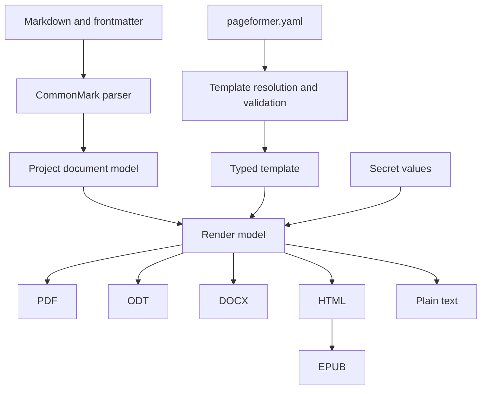

# Architecture

Pageformer turns a Markdown document plus one YAML template into several output formats. The pipeline is shared; only the last step changes.

## Document model

Markdown is parsed into a project-owned document model, not into backend-specific structures. The model holds semantic blocks and inlines, such as headings, paragraphs, lists, tables, quotes, code, images and footnotes, and carries no layout decisions. Backends read the model and never parse Markdown themselves.

The template is parsed and validated separately into a typed structure. An invalid template is fatal: the renderer never falls back to another template, because a document generated with the wrong template is worse than no document.

The Markdown subset is CommonMark plus the extensions the Zed preview renders: tables, task lists, strikethrough, footnotes, alert block quotes and YAML frontmatter. Fenced code blocks are preserved. Raw HTML is not part of the contract, so the parser rejects it instead of dropping it silently.

## Crate layout

- `src/document.rs` holds the backend-independent model, with newtypes and smart constructors for the values the pipeline validates.
- `src/markdown.rs` parses CommonMark plus the extensions into the model. It is total: malformed event streams, raw HTML and nesting deeper than 128 levels become `MarkdownError` values.
- `src/template/` holds the versioned YAML schema and the loader that resolves which template applies.
- `src/pdf/` is the PDF backend: `source.rs` generates Typst source, `assets.rs` reads local images and the letterhead, and `world.rs` is the Typst world that serves them.
- `src/main.rs` is the CLI. It parses each input, resolves the template and either renders a PDF or reports the pipeline result.

The library is the pure core. File reading, the environment and the terminal live in the binary or in the loader's explicitly named functions.

## Consistency

Every format shares the semantic template. The current schema defines page size, orientation, margins, font families, text size, leading, alignment and the letterhead image. Colors, heading styles and header and footer content are pending schema work.

The promise is consistency of presentation, not identical content distribution. Pagination differs between paged formats, such as PDF, and reflowable formats, such as ODT, DOCX and EPUB. The project does not try to force the same distribution. Widows and orphans must be avoided where the engine allows it.

## Template resolution

The nearest `.pageformer.yaml` wins entirely. There is no merge across directories: a local template replaces the global template and the embedded fallback. If the winning template is invalid, generation fails with a diagnostic that identifies the file, line and column.

The global template lives in the user configuration directory. A minimal fallback is embedded in the binary.

Paths inside the template, such as the letterhead image or a font file, resolve relative to the template file, not to the working directory.

## Output

Without secrets, the output is written next to the Markdown source, with the same name and the new extension. `--output` selects another directory, and the program creates it when missing. Writes are atomic. With secrets, the output must be written to a directory outside the source tree, given explicitly; the program refuses to write a secret-bearing document next to its sources. Secrets are not implemented yet.

## Secrets

Placeholders use the form `{NAME}` in the document body, with an uppercase name such as `{NOME_COMPLETO}`. Single braces are literal text in CommonMark, so both the parser and the Zed preview keep them intact. The angle-bracket form is rejected because `<NAME>` is parsed as inline HTML.

Every token that matches `{[A-Z][A-Z0-9_]*}` is reserved for a secret. An unknown placeholder is a fatal error, never text left in the final document. The pattern does not apply inside code spans, code blocks or URLs, where the text is reproduced literally. A lowercase or spaced brace, such as `{nome}`, is ordinary text.

Placeholders are resolved only in body content. One found in frontmatter metadata is an error, because secret values must never reach the PDF XMP package, the DOCX core properties or the ODT metadata.

Secret values are loaded from a file outside the source tree, or from the environment, and are never accepted as command-line arguments. They are redacted from debug output and error messages and never printed to the console. A `--check` run reports placeholder names only.

Metadata comes from the template and the frontmatter only. The document model replaces placeholders at render time, after parsing and before a backend sees the content.

## Formats

- PDF is the primary output and must conform to PDF/A-2b, or PDF/A-2u when every character maps to Unicode.
- ODT is the second priority.
- DOCX follows.
- HTML, plain text and EPUB reuse the same document model. HTML is the basis for EPUB, which splits chapters at first-level headings and uses deterministic metadata.
- Plain text is a view of the model, used by the copy-as-plain-text action.

## PDF engine

The engine is Typst, used as a library. The constraint is a self-contained binary, with no Chromium, no webview and no external converter, and Typst satisfies it while providing the layout work the project would otherwise have to implement.

Typst provides pagination, headers and footers, page numbering, explicit page breaks, automatic avoidance of single-line widows and orphans, system font discovery, font subsetting and embedding, PDF/A-2b, PDF/A-2u and PDF/UA-1. The Typst language stays internal: the YAML template and the document model generate Typst content, and users never write Typst. A small `World` implementation for fonts and file access is preferred over a wrapper with an unstable API.

The crate is Apache-2.0, compatible with the project license.

### The current backend

`src/pdf` turns the model into Typst source and compiles it with the same Typst 0.15.1 library the spike used. The template sets the page dimensions, orientation, margins, letterhead, font families, size, leading and alignment; the frontmatter overrides the template's document defaults. The document date is fixed to 2026-01-01 UTC and the world reports the same date, so the same input produces the same bytes.

User text is escaped for Typst markup (`\`, `#`, `$`, `*`, `_`, `` ` ``, brackets, angle brackets, `@`, `~`, `-`, `+`, `/`, `=`, `:`, `&`, braces and periods; the period keeps `1.` from becoming an enum marker). Strings passed to Typst functions are escaped for Typst string literals. Local images are read at the edge, stored under a synthetic project path and served by the world; remote images are rejected. The letterhead resolves against the template file and the images resolve against the Markdown file.

Embedded fonts are loaded before system fonts, so Libertinus Serif is always available as the last family in the default list. This keeps the binary self-contained, while a template can still prefer system fonts.

Header and footer content, heading page breaks and configurable table styling are not part of the schema yet. The backend therefore uses Typst's default heading and list styles, a neutral table grid and no header or footer.

### Spike results

The first spike (Typst 0.15.1, Rust 1.99.1, release profile with thin LTO and stripped symbols) rendered a nine-page A4 contract with system fonts, a header, a footer with page numbers, a table and signature lines.

| Measurement | Result |
|---|---|
| Binary size | 40,387,192 bytes (about 38.5 MiB) |
| Clean build | 62.6 s, peak RSS about 1.9 GiB |
| Runtime | about 0.17 s, peak RSS about 33 MiB |
| Output | 73,781 bytes, PDF 1.7, nine A4 pages, tagged |
| Fonts | Liberation Serif regular, bold and italic, embedded and subsetted |
| PDF/A-2b | PASS with veraPDF 1.31.207 |

The document date is fixed to 2026-01-01 UTC, so the output was deterministic: two runs and a clean rebuild produced the same SHA-256. The spike was removed when the real crate layout replaced it. The current backend reuses the same engine and fixes the date the same way; the measurements above remain the reference for build, binary size and runtime, but were not re-run for the backend.

The AST-to-Typst layer escapes user text before emitting Typst: `$` opens math, `*` and `_` mark emphasis, `#` starts code, and brackets open content blocks. PDF/A also requires a document date, so the generator sets one explicitly. See "The current backend" above for the implemented escaping and date policy.

krilla remains the fallback. It is a high-level PDF writer with PDF/A and PDF/UA support, but it explicitly leaves text layout, tables, page breaking and headers to the caller; choosing it would mean implementing those algorithms in the project.

PDF/A output is validated with veraPDF, because producing a valid PDF/A file is not the same as conforming to the profile. Both example PDFs pass veraPDF 1.30.3 as PDF/A-2b; the test suite checks the PDF header, the PDF/A markers and deterministic bytes, and leaves the full veraPDF run to the verification commands in `docs/verification.md`.

## Testing

Pure tests cover the document model, the Markdown parser, template validation, template resolution and the Typst source generation. The fixtures in `assets/examples/` drive the parser and PDF tests. HTML and plain text will be compared as text once those backends exist. ZIP-based formats will be checked structurally. PDF output is checked for the PDF header and the PDF/A markers, and the same input must produce identical bytes in two runs. A corpus of real documents is kept as fixtures, because typography regressions do not appear in synthetic samples.

The parser also has property tests that assert arbitrary text is either accepted or rejected without panicking. The template parser has the same property.

The fixtures are in `assets/examples/`: `Contrato.md` with `Contrato.pdf`, and `Embargos.md` with `Embargos.pdf`, generated with `Embargos.pageformer.yaml`. The PDFs are outputs of the current backend, not byte targets; both pass veraPDF as PDF/A-2b.

## Open decisions

- Explicit page breaks and the Markdown syntax that requests them.
- Header and footer content, heading styles, heading page breaks and table styling in the template schema.
- ODT implementation: a native ODF writer or another path.
- DOCX library choice and the shared document model for reflowable formats.
- Secret file format and permission checks.
- Folder input and generating every Markdown file found inside it.
