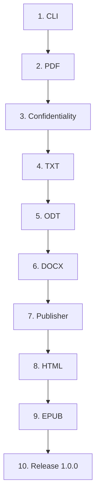

# Roadmap

Pageformer is close to 1.0.0. The engine, the command line, the six output formats and the minimal converter window are implemented and tested. This page records what each phase delivered, why the work happened in that order, and what still has to be true before the project promises a stable template and document model.

## Status at a glance

| Phase | Outcome | Released |
|---|---|---|
| 1. CLI | Files and directories, deterministic batches, atomic writes, ANSI output | 0.6.0 |
| 2. PDF | The primary backend, PDF/A-2b, running content and page control | 0.12.0, expanded through 0.41 |
| 3. Confidentiality | `{NAME}` fields, the INI file and the user-level folder mapping | 0.13.0, mapping in 0.40.0 |
| 4. TXT | The renderer boundary and the plain-text view | 0.15.0 |
| 5. ODT | The internal ODF writer and deterministic packaging | 0.16.0 |
| 6. DOCX | The internal OOXML writer and deterministic packaging | 0.17.0 |
| 7. Publisher | The minimal egui converter over the shared pipeline | 0.35.0 |
| 8. HTML | The self-contained semantic view | 0.35.0 |
| 9. EPUB | The EPUB 3 package built on the HTML conversion | 0.36.0 |
| 10. Release 1.0.0 | Stability review, full verification and a signed tag | Pending |

## Why this order

The command line came first because input discovery, format selection and output rules are the contract every backend sits behind. Changing them after five backends existed would have touched every test and every usage example.

PDF came second because it is the primary output and the reference for the document model. The later backends copied decisions about headings, lists, tables, footnotes, images and metadata that the PDF forced the project to make.

Confidentiality came third, before the remaining backends. Placeholder resolution belongs to the pipeline, after parsing and before rendering. Implementing it later would have meant writing the same scanner into several backends and then removing it.

TXT came fourth because it is the cheapest backend and the first one that justified a shared renderer boundary. It proved the contract with little machinery and supplied the copy-as-plain-text action the window later exposed.

ODT and DOCX came next because they are the office formats with the highest legal value and the closest semantic match to the PDF. They also forced the shared style mapping, deterministic ZIP packaging and structural tests that HTML and EPUB reused.

The minimal window came after the formats it exposes, so its buttons mapped to a stable pipeline instead of promises. HTML followed because a correct HTML view is the prerequisite for EPUB; EPUB is HTML packaged with chapters and metadata. Pageweaver, the separate editor, is not part of this roadmap's release; it consumes the same library for export and preview.

Release 1.0.0 comes last and is not a feature. It is the point where the template schema and the document model are stable enough to promise compatibility.

## What remains for 1.0.0

The remaining work is a stability pass, not a new format:

1. **Review stability.** Confirm that no breaking change to the template schema or the document model is pending. Optional template keys may still be added without breaking existing documents; removing or changing an existing key cannot happen after 1.0.0 without a major release.
2. **Run the full verification matrix.** Run the Rust checks, Markdown lint, veraPDF on the three examples, the LibreOffice conversion for ODT and DOCX, the EPUB structural checks, and a smoke test on Windows and macOS. The commands are in [`verification.md`](verification.md).
3. **Refresh the documentation.** Read the README and every file in `docs/` as one set, remove stale statements and make sure the examples match the current behavior.
4. **Consolidate the changelog.** Keep the user-visible history and make the 1.0.0 notes state the compatibility promise.
5. **Set the version and tag.** Set `1.0.0` in `Cargo.toml`, create a signed tag, push it to the canonical bare and publish the project.

The compatibility promise after 1.0.0 is intentionally simple: an additive optional template key is a minor application release and keeps the current schema version; removing a key or changing its meaning is a major release and bumps the schema version; a deprecated key keeps working for one minor cycle.

## Contract for a release

A release is ready when all of the following are true:

- The new behavior has a test that fails before the change and passes after it.
- `cargo fmt --check`, `cargo clippy --workspace --all-targets --all-features -- -D warnings`, `cargo test --workspace --all-features -- --test-threads=1`, `cargo test --doc` and `cargo doc --no-deps` pass.
- Markdown lint passes and the examples are regenerated when the output changed.
- Expected failures are error values with domain variants. Library code has no `unwrap`, `expect`, `panic!` or unchecked indexing.
- User-visible changes update `README.md`; settled decisions update `docs/architecture.md`; schema changes update `docs/template.md`; new validation tools update `docs/verification.md`.
- `CHANGELOG.md` records the change, and the version follows the rules in `README.md`.

## Template schema map

The schema version is `0.7`. The embedded `assets/default.pageformer.yaml` is the complete reference: every accepted key is declared there, and keys that are absent by design are commented.

| Area | Keys | Notes |
|---|---|---|
| Version | `version` | A quoted two-part string; this build accepts only `"0.7"`. |
| Page | `page.size`, `page.orientation`, `page.margins`, `page.background`, `page.letterhead` | Size, orientation and margins reach the paged formats and HTML; EPUB uses only the background. The letterhead is shared by the paged formats and the HTML print page. |
| Running content | `page.header`, `page.footer` | Left, center and right slots with the lowercase page and metadata tokens. |
| Paragraph | `formatting.paragraph` | Font families, size, weight, style, leading, spacing, alignment, foreground, background and the inline overrides. |
| Inline spans | `emphasis`, `strong`, `code`, `strikethrough`, `link` | Inherit the paragraph face; only declared keys override it. A link adds `underline`, off by default. |
| Blocks | `formatting.quote`, `formatting.code_block` | Face, colors, alignment and per-side border. Both are left aligned by default. |
| Headings | `formatting.heading`, `h1` to `h6` | A base map plus per-level overrides for font, size, weight, style, spacing, page break, background and rule. A level clears an inherited value with `none`. |
| Horizontal rule | `formatting.horizontal_rule` | Thickness, color and spacing for the thematic break and for a heading rule. |
| Lists | `formatting.list` | Item face, colors and alignment, indent, marker gap, bullets, numbering formats with a suffix, and loose-item spacing. |
| Task lists | `formatting.list.task` | Gap, bullet visibility, and the done and todo marker strings and styles. |
| Images | `formatting.image` | Block image alignment, maximum width, per-side border with padding, and background. |
| Tables | `formatting.table` | Border, border color, header fill and cell padding. |

Schema evolution follows one rule: an optional key that preserves the meaning and the output of existing templates keeps the current schema version; removing a key or changing its meaning bumps the schema version and is a breaking change. A newer template with an unknown key is rejected by an older build, which is the intended failure.

## Frontmatter map

| Field | Purpose |
|---|---|
| `title`, `author`, `language` | Document metadata. The PDF uses the title as metadata, and the visible title is the first-level heading. |
| `date` | The document date. It replaces the fixed PDF date when present. |
| `subject`, `keywords` | PDF metadata and HTML meta tags. |
| `identifier` | The stable EPUB identifier. Without it, EPUB derives a UUID v5 from the content. |

## Risks to watch

- **Repeated escaping.** Each output language needs its own escaper: Typst markup and strings, XML, HTML and JSON in EPUB metadata. Share the rule that user text is never trusted, not the escaping code.
- **Broken determinism.** ZIP timestamps, random identifiers, map iteration order and the current time are the usual causes. Keep them fixed in every ZIP format, and assert byte equality in every output test.
- **Confidential leaks through diagnostics.** Compilers quote source text. Redact known values at the error boundary, not only on the happy path.
- **Unsafe link schemes.** Reject `javascript:` and `data:` at the shared model boundary, so no backend can emit a dangerous target.
- **Blocking the window.** A render can take long enough to freeze a frame loop. Keep it on a worker thread.
- **Schema drift.** Adding fields without updating `docs/template.md` and the tests makes the version meaningless. Treat the schema map above as part of the release contract.
- **Premature abstraction.** Do not add a backend-specific hook before two backends need it, and do not start the editor before the formats it exposes exist.
