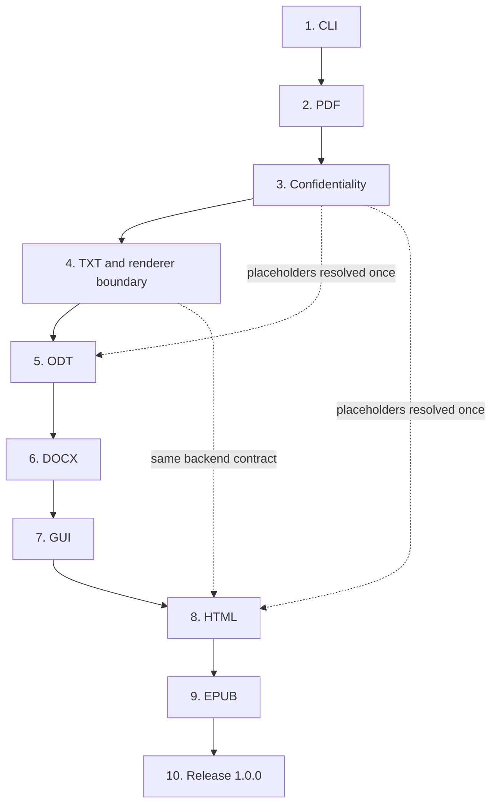

# Implementation Map

Pageformer reaches 1.0.0 through ten phases, in the order below. The order is a dependency chain, not a wish list: each phase removes an uncertainty that the next one would otherwise inherit. This map starts from the state at 0.5.0. The settled decisions live in [`architecture.md`](architecture.md), the schema in [`template.md`](template.md) and the verification tools in [`verification.md`](verification.md); this file only orders the work and states what closes each phase.

## Status at a glance

| Phase | Scope | Status | Starts after |
|---|---|---|---|
| 1. CLI | Input discovery, format selection, output rules | Done in 0.6.0: files and directories, path-ordered batches, mirrored output, ANSI styling | 0.5.0 |
| 2. PDF | Primary output and reference backend | Done in 0.12.0: running header and footer with tokens, explicit page breaks, per-level page starts, table styling and the frontmatter `date`, `subject` and `keywords`; PDF/A-2b stays the declared profile | CLI output rules |
| 3. Confidentiality | Placeholder resolution and leak prevention | Done in 0.13.0: `{NAME}` fields, environment and file loading, output rule, redaction | PDF pipeline |
| 4. TXT | Plain-text view and the renderer boundary | Done in 0.15.0: the renderer trait, `--format txt` and plain-text goldens | Confidentiality |
| 5. ODT | Second-priority paged format | Done in 0.16.0: internal ODF writer, deterministic package, styles from the template | Renderer boundary |
| 6. DOCX | Office format for review and exchange | Done in 0.17.0: internal OOXML writer, numbering instances, repeating table headers, footnotes and a deterministic package | ODT style mapping |
| 7. GUI | Minimal egui window over the pipeline | Not started | Every format it exposes |
| 8. HTML | Self-contained semantic view | Not started | GUI and renderer boundary |
| 9. EPUB | HTML packaged with chapters and metadata | Not started | HTML |
| 10. Release 1.0.0 | Stability review and release | Not started | Every phase above |

## Why this order

The CLI comes first because input discovery, format selection and output rules are the contract every backend sits behind. Changing them after five backends exist would touch every test and every usage example.

PDF comes second because it is the primary output and the reference for the document model. Every later backend copies decisions about headings, lists, tables, footnotes, images and metadata that the PDF backend forces us to make now.

Confidentiality comes third, before the remaining backends. Placeholder resolution belongs to the pipeline, after parsing and before rendering. Implementing it after TXT, ODT or DOCX would mean writing the same scanner into several backends and then removing it.

TXT comes fourth because it is the cheapest backend and the first one that justifies a shared renderer boundary. It proves the trait with the least machinery, and it supplies the copy-as-plain-text action the GUI needs later.

ODT and DOCX come next because they are the office formats with the highest legal value and the closest semantic match to the PDF. They also force the shared style mapping, the deterministic ZIP packaging and the structural tests that HTML and EPUB will reuse.

The GUI comes after the formats it exposes, so its buttons map to a stable pipeline instead of to promises. HTML follows because a correct HTML view is the real prerequisite for EPUB; EPUB is HTML packaged with chapters and metadata.

Release 1.0.0 comes last and is not a feature. It is the point where the template schema and the document model are stable enough to promise compatibility.

## Contract for every phase

A phase is closed only when all of the following hold:

- The new behavior has a test that fails before the change and passes after it; the full Rust suite, `cargo fmt --check`, `cargo clippy --all-targets --all-features -- -D warnings`, `cargo test --doc` and `cargo doc --no-deps` pass.
- A backend receives a parsed document, a validated template and resolved assets, and returns bytes plus warnings. It never parses Markdown, reads a file, reads the environment or writes to disk.
- Expected failures are error values with domain variants. No `unwrap`, `expect`, `panic!` or unchecked indexing is added to library code.
- User-visible changes update `README.md`; settled decisions update `docs/architecture.md`; schema changes update `docs/template.md`; new validation tools update `docs/verification.md`.
- Output changes regenerate the examples and re-run their verification. Deterministic outputs stay byte-identical across two runs.
- `CHANGELOG.md` records the change, and the version follows the rules in `README.md`.

## Phase 1: CLI

**Goal.** Make one invocation the stable contract for every format: what is read, which format is produced, where it is written and what the exit code means.

**Current state.** Positional file arguments, `--template`, `--output`, `--check`, per-file diagnostics, atomic writes and `--version`. Each input is parsed and resolved independently.

**Status.** Done in 0.6.0: directory discovery, output planning, generalized atomic writes and ANSI-styled output.

**Work.**

- Accept directories as inputs, walk them recursively, collect `.md` files in lexicographic path order and skip hidden directories and `target/`. Do not follow directory symlinks, so a cycle cannot hang the run. A directory with no Markdown is a warning, not a failure.
- Introduce an internal `OutputFormat` enum now, with `Pdf` as the only exposed variant. Add `--format` when the second backend lands. The enum keeps the CLI free of stringly-typed branches later.
- Generalize `write_atomic`: it currently hardcodes `pdf.tmp`. Derive the temporary name from the final extension and keep the same-directory rename, so the write stays atomic for every format.
- Keep the current overwrite policy: an existing output is replaced atomically. Add a flag only if a real user need appears.
- Keep processing the batch after a failure, report one error per input on stderr, and exit with `1` when any input fails. `--check` keeps reporting success without writing.
- Keep help and error strings in English, stable enough to test, and never print document content.

**Done when.** `pageformer docs/` renders every Markdown file under the tree in a deterministic order, one bad file does not stop the others, both modes are covered by CLI tests that write only to temporary directories, and no test writes into `assets/examples/`.

## Phase 2: PDF

**Goal.** Turn the current backend into the reference implementation: the schema fields every paged format needs, with PDF/A conformance and deterministic bytes preserved.

**Current state.** PDF/A-2b through Typst 0.15.1, page size, orientation, margins, letterhead, body and title styles, leading, paragraph spacing, header spacing, alignment, local images, headings, lists, tables, quotes, code, footnotes, embedded fonts and a fixed document date.

**Status.** Started in 0.7.0 and expanded in 0.9.0 with schema 0.5, `formatting.paragraph`, `formatting.heading` with `h1` to `h6`, weight, style, inline emphasis and strong overrides, point lengths and a length-based leading. In 0.10.0 the optional `page.header`, `page.footer` and `table` sections, the `Block::PageBreak` model block and the frontmatter `date`, `subject` and `keywords` landed inside schema 0.5, because omitting them preserves the output of an existing template. The examples demonstrate them in 0.10.1: the shared template adds a page-number header clear of the letterhead, and the nested `tecnico/` example uses its own template without a letterhead to show the full header, footer, table style and page break. In 0.11.0 the page-break marker became `{pagebreak}`. Phase 2 closed in 0.12.0 with `page_break_before` per heading level, a weak break that does not create a blank page. An inline audit in 0.12.1 added tests for every inline construct and documented the exclusions: math, superscript, subscript, highlight, wikilinks and inline HTML stay outside the contract. Superscript and subscript are deferred until after 1.0.0, because the Zed preview does not render them and `~x~` is already strikethrough. Typst already avoids widows and orphans through its paragraph costs, so no field is exposed, and PDF/A-2u is not declared: veraPDF reports only the conformance identifier for 2u when the file declares B.

**Work.**

- Add optional template fields with defaults that preserve the current output: `page.header` and `page.footer` with left, center and right slots; `table` for borders, header fill and cell padding; and a per-level heading flag that starts a new page.
- Define template tokens separately from document confidential fields. Lowercase tokens such as `{page}`, `{pages}`, `{title}` and `{author}` are expanded only in header and footer slots, and an unknown lowercase token is a template error. Uppercase `{NAME}` is a body field and is rejected in running content.
- Set the Typst text language from the frontmatter, pass image alternative text, keep table header rows and footnotes semantic, and let Typst build the outline from headings. Check that the tagged output survives these changes.
- Extend the frontmatter only when a backend needs the field. Candidate fields for this phase are `date`, which replaces the fixed date when present and must also drive the Typst world date so deterministic output holds, plus `subject` and `keywords`. Each new field is validated and documented in `docs/template.md`.
- Expose Typst's widow and orphan handling only through template fields that the examples actually use. Do not add knobs speculatively.
- Keep PDF/A-2b as the default. Decide whether to emit PDF/A-2u when every character maps to Unicode, as the architecture allows, and keep PDF/UA-1 out unless a user need appears.

**Done when.** Every new field has a schema test, a source-generation test and an example that uses it; all fixtures still pass veraPDF as PDF/A-2b; two runs produce identical bytes; the page-break and token rules are documented in `docs/architecture.md` and `docs/template.md`.

## Phase 3: Confidentiality

**Goal.** Resolve placeholders once, in the model, before any backend, and make a leak impossible by construction.

**Status.** Done in 0.13.0, with the values file moved to an INI-style format in 0.14.0. The design is described in [`architecture.md`](architecture.md#confidentiality) and the implementation lives in `src/confidential.rs` and `src/confidential/loader.rs`. The example workflow lives in `escritorio/`, `confidencial/` and `publicacao/`: `Embargos.md` uses fields for the fictional names, documents, addresses, court, process number, lawyers and case identifiers, and `embargos.ini` supplies the values. The example workflow lives in `escritorio/`, `confidencial/` and `publicacao/`: `Embargos.md` uses fields for the fictional names, documents, addresses, court, process number, lawyers and case identifiers, and `embargos.ini` supplies the values.

**Work.**

- `ConfidentialName` is an uppercase `[A-Z][A-Z0-9_]*` newtype, and `ConfidentialValue` never prints itself through `Debug` or `Display`. The value is built only by the loader.
- Only text inlines are scanned. Code spans, code blocks, link destinations, link titles, image destinations and frontmatter are excluded. A lowercase or spaced brace such as `{nome}` stays ordinary text.
- An unknown placeholder is fatal. The error names the placeholder and its block location, never a value, and never leaves the token in the output.
- Values come from `PAGEFORMER_CONFIDENTIAL_<NAME>` environment variables or from an INI-style `NAME = value` file outside the source tree; no value is accepted on the command line. Whitespace around the name, the `=` and the value is trimmed, `#` and `;` start a comment only at the beginning of the line, and sections, quotes and escapes are not supported. The file overrides the environment, duplicate names are rejected and Unix requires `chmod 600`.
- Substitution happens after parsing and before asset loading, so every backend receives final text. The model returns a new document; the store never reaches a backend.
- A document with confidential fields requires an output directory outside its source tree. Paths are canonicalized before the comparison, so `.` and `..` cannot disguise an output inside the tree. `--check` lists field names only.
- Known values are redacted from warnings and errors before they reach stderr, because Typst diagnostics can quote the generated source.
- Tests cover substitution in every container, code and destinations untouched, frontmatter rejection, the output rule, `--check` names only, the permission check and the file and environment precedence. The CLI test asserts that no value appears in stdout, stderr or the PDF XMP metadata.

**Done when.** A confidential document cannot be written next to its source, no output path can expose a value, and every later backend receives substituted text from the model without ever seeing the store.

## Phase 4: TXT

**Goal.** Prove the renderer boundary with the cheapest format and supply the copy-as-plain-text action the GUI will expose.

**Status.** Done in 0.15.0. `src/render.rs` holds the `Renderer` trait and the backend-neutral `Rendered` value; `src/txt.rs` implements the text view without assets and without failure; `--format` selects `pdf` or `txt`; the office and technical examples have text goldens beside their PDFs.

**Work.**

- Introduce the `Format` enum and the renderer contract, and move PDF under it. The pipeline resolves the document, template and assets, then calls one backend that returns bytes and warnings. Keep the trait small and backend-neutral.
- Extract asset resolution from `src/pdf/assets.rs` only as far as the new backends need it. The per-format policy stays explicit, for example PDF and ODT reject PDF images while HTML can embed them.
- Decide and document the plain-text rules: UTF-8 with LF, no automatic wrapping, one blank line between blocks, headings as their text, dash and ordered markers followed by a space (for example `-` and `1.`), nested indentation, tables as tab-separated cells with a separator row, quotes prefixed by a greater-than sign and a space, code blocks preserved, links as `label (destination)`, images as `[alt]`, footnotes collected at the end, soft breaks as spaces and hard breaks as newlines.
- TXT ignores layout fields, but the semantic template is still resolved, so a broken template fails the same way for every format.
- Add `--format txt` and the `.txt` output rule. The default output stays next to the source unless `--output` is given.
- Add golden text fixtures for both examples and focused cases for tables, lists, quotes and footnotes. Normalize line endings in the comparison, not in the output.

**Done when.** `--format txt` writes a readable file for both fixtures, the PDF output is unchanged by the new boundary, and the GUI can call the same pure function without a second conversion path.

## Phase 5: ODT

**Goal.** Deliver the second-priority format with the same semantic styles as the PDF.

**Status.** Done in 0.16.0. `src/odt/` writes the ODF parts and `src/zip.rs` packages them with stored entries and fixed timestamps. Page layout, fonts, headings, tables, letterhead, running header and footer, footnotes, images and metadata are mapped from the template and the model. The three examples are generated as ODT, open in LibreOffice without repair, and the packages are byte-identical across runs.

**Work.**

- Choose the writer before coding. Prefer a small internal ODF writer, with a minimal ZIP dependency, over a full ODT library, unless a maintained crate covers styles, images, footnotes and deterministic packaging; record the decision in `docs/architecture.md`. Reject a crate that cannot express the template fields.
- Build the package with `mimetype` first and stored, then `META-INF/manifest.xml`, `content.xml`, `styles.xml` and `meta.xml`. Fix the entry order and timestamps.
- Map the template to ODF styles: page layout, font faces with a generic fallback, size, leading, paragraph spacing, alignment, headings, lists, tables, letterhead and footnotes.
- Map the document to ODF content: blocks, inlines, images under `Pictures/`, links and footnotes. Alerts become block quotes with a visible label, because ODF has no alert concept.
- Write title, author, language and generator to the metadata. Never write a confidential value.
- Test the package structurally: unzip, parse every XML part, assert that `mimetype` is first and stored, and compare two renders byte for byte. Add an optional LibreOffice headless conversion as a smoke test and document the command in `docs/verification.md`.

**Done when.** Both fixtures open without repair, the text and structure match the model, a style change in the template is visible in the ODT, and two runs are byte-identical.

## Phase 6: DOCX

**Goal.** Produce the format reviewers expect, with lists, tables and footnotes intact.

**Status.** Done in 0.17.0. `src/docx/` writes the OOXML parts and package, reusing `src/zip.rs` and the shared metrics. Every list has its own numbering instance with start overrides, table header rows repeat, the template supplies borders, fill and padding, footnotes and hyperlinks are packaged, and the letterhead floats behind the header. The three examples open in LibreOffice without repair and are byte-identical across runs.

**Work.**

- Choose between `docx-rs` and a hand-written OOXML writer, judged by determinism and coverage of the template fields. Reuse the semantic style resolution from ODT, never the ODF XML.
- Build the package: content types, relationships, `word/document.xml`, `word/styles.xml`, `word/numbering.xml`, `word/footnotes.xml`, media, and the core and app properties.
- Give each list its own numbering instance, so legal numbering restarts where the document says and tight and loose lists stay distinct.
- Repeat table header rows, apply borders and cell padding from the template, and take cell alignment from Markdown.
- Fix the core properties, the relationship ids, the numbering ids and the ZIP timestamps for determinism.
- Test the package structurally, smoke-test it in LibreOffice on Linux and in Word on Windows when available, and optionally round-trip it to text. DOCX has no conformance profile comparable to PDF/A.

**Done when.** Both fixtures open in Word and LibreOffice without repair, lists and footnotes survive the round trip, and two runs produce identical bytes.

## Phase 7: GUI

**Goal.** Expose the pipeline in a minimal egui window without duplicating any of it.

**Work.**

- Launch with `--gui`; the terminal remains the main workflow.
- Follow the sketch: a drop box, format buttons enabled only after a valid Markdown file, a template label with edit and open-folder actions, a status line and an open-output action.
- Model the window as a state machine with `Idle`, `Working`, `Succeeded` and `Failed`. Render on a worker thread and communicate through a channel, so the frame loop never blocks; a second request while working is disabled, not queued.
- Call the same pipeline. The GUI never parses Markdown, resolves a template or writes a file itself.
- Require an output directory outside the source tree when the document contains placeholders, and never display a confidential value.
- Show errors in the status line and never panic on a bad file, a missing template or a failed render.
- Test the pure state transitions, input validation and button enablement. Keep the manual smoke test documented; use snapshot tests only if they stay deterministic.

**Done when.** A file can be dragged in and every implemented format generated, a template failure is visible without a crash, and the window stays responsive during a render.

## Phase 8: HTML

**Goal.** Produce a self-contained HTML view and the base for EPUB.

**Work.**

- Write one `.html` file with embedded CSS and data-URI images. The output makes no network request and is suitable for email.
- Use semantic HTML: headings, paragraphs, lists, tables with `thead`, block quotes, alerts, code with language classes, footnotes with `role="doc-endnotes"` and images with `alt`.
- Derive CSS from the template: page size and margins for print, fonts, size, leading, paragraph spacing, alignment, heading styles and table styling. Decide how the letterhead appears on screen and in print, and do not fake pagination.
- Escape all text and attributes. Link destinations may be remote and are emitted escaped, never fetched; images stay local and embedded. Restrict schemes to `http`, `https` and `mailto` and reject `javascript:` and `data:` at the boundary.
- Take title, author and language from the frontmatter.
- Fix the order of style rules and attributes for deterministic bytes.
- Compare the rendered HTML as normalized text for both fixtures, and add focused tests for escaping, tables and footnotes.

**Done when.** The file opens offline, print preview follows the template, and the block and inline conversion is reusable by the EPUB backend.

## Phase 9: EPUB

**Goal.** Package the HTML view as an EPUB 3 without a second converter.

**Work.**

- Split at each first-level heading; content before the first heading becomes the introduction; empty chapters are skipped. Build the navigation from the same headings.
- Reuse the HTML block and inline conversion, adding a chapter wrapper, a CSS subset and the metadata.
- Build the package with `mimetype` first and stored, then `META-INF/container.xml`, `content.opf`, `nav.xhtml`, chapters, CSS and images.
- Take title, language and author from the frontmatter. Settle the identifier: the architecture proposes a random UUID v4 per build, which conflicts with deterministic output; prefer a UUID v5 derived from a stable content hash unless the frontmatter supplies an identifier. Record the decision.
- Validate with `epubcheck` when installed, test the package structurally, and compare two renders byte for byte.

**Done when.** The EPUB passes `epubcheck`, chapters and navigation match the headings, images display offline, and two runs produce identical bytes.

## Phase 10: Release 1.0.0

**Goal.** Declare the document model and the template schema stable.

**Work.**

- Review stability: no pending breaking change to the template schema or the document model, and every promised format implemented and documented.
- Run the full verification matrix: the Rust checks, Markdown lint, veraPDF on both examples, DOCX, ODT and EPUB validation, a Linux smoke test and a Windows and macOS check.
- Set `1.0.0` in `Cargo.toml`, consolidate `CHANGELOG.md`, refresh the README usage and examples, and create a signed tag.
- State the compatibility promise for after 1.0.0: additive optional template keys are minor app releases and keep the current schema version; removing or changing a key is a major release and bumps it; a deprecated key keeps working for one minor cycle.

**Done when.** The full verification matrix passes on a clean checkout and the release notes state the compatibility promise.

## Template schema map

| Area | Keys | Phase | Notes |
|---|---|---|---|
| Version | `version` | 0.9.0 | Two-part string; schema `0.5` is current. |
| Page | `page.size`, `page.orientation`, `page.margins`, `page.letterhead` | 0.5.0 | Shared by every paged format. |
| Paragraph | `formatting.paragraph` | 0.9.0 | Font families, size, weight, style, leading, spacing, alignment and inline overrides. |
| Inline spans | `formatting.paragraph.emphasis`, `formatting.paragraph.strong` | 0.9.0 | Inherit the paragraph face; style italic and weight bold are the semantic defaults. |
| Headings | `formatting.heading`, `formatting.heading.h1` to `h6` | 0.12.0 | Base plus per-level overrides for fonts, size, weight, style, spacing and `page_break_before`. |
| Header and footer | `page.header`, `page.footer` | 0.10.0 | Running content in left, center and right slots; lowercase tokens only. |
| Tables | `table` | 0.10.0 | Border, border color, header fill and cell padding. |
| EPUB | `epub.split_at` | After 1.0.0 | Defaults to first-level headings. |

Schema evolution follows one rule: an optional key that preserves the meaning and the output of existing templates keeps the current schema version; removing a key or changing the meaning of an existing one bumps the schema version and is a breaking change. A newer template with an unknown key is rejected by an older build, which is the intended failure.

## Frontmatter map

| Field | Phase | Purpose |
|---|---|---|
| `title`, `author`, `language` | 0.5.0 | Document metadata; the PDF uses the title as metadata, and level-1 headings use `formatting.heading.h1`. |
| `date` | 0.10.0 | Document date; replaces the fixed date when present. |
| `subject`, `keywords` | 0.10.0 | PDF metadata and HTML meta tags. |
| `identifier` | 9 | Stable EPUB identifier; overrides the derived UUID. |

## Risks to watch

- **Repeated escaping.** Each output language needs its own escaper: Typst markup and strings, XML, HTML and JSON in EPUB metadata. Share nothing between them except the tests and the rule that user text is never trusted.
- **Broken determinism.** ZIP timestamps, random identifiers, map iteration order and current time are the usual causes. Fix the first three as soon as the first ZIP format lands, and assert byte equality in every output test.
- **Confidential leaks through diagnostics.** Compilers quote source text. Redact known values at the error boundary, not only in the happy path.
- **Unsafe link schemes.** The parser accepts any link destination today. HTML must reject `javascript:` and `data:`, and the shared model should validate schemes once so no backend can emit a dangerous target.
- **Blocking the GUI.** A render takes long enough to freeze a frame loop. Keep it on a worker thread from the first version.
- **Schema drift.** Adding fields without updating `docs/template.md` and the tests makes the version meaningless. Treat the schema map above as part of the phase contract.
- **Premature abstraction.** Do not add a backend-specific hook to the renderer before two backends need it, and do not start the GUI before the formats it exposes exist.
