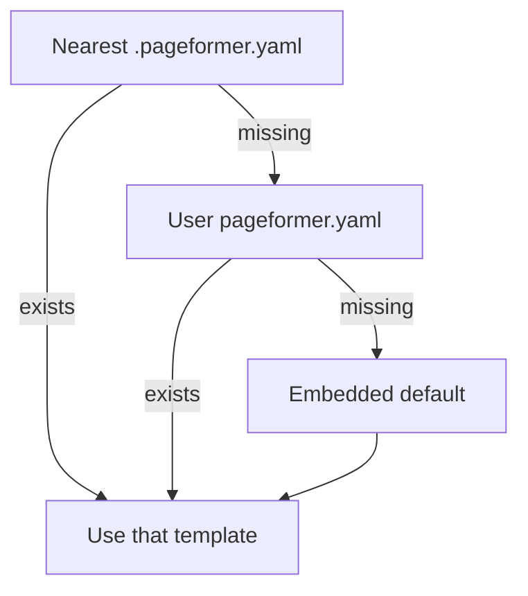

# Template

One YAML template drives every output format. The schema is versioned, and a template written for another version is rejected instead of being interpreted with different rules. The embedded `assets/default.pageformer.yaml` is the complete reference: it declares every accepted key, with a short comment before each main group, and commented keys show what is available but absent by design.

## Resolution

A document uses exactly one template. Pageformer looks in three places, in this order, and the first one that exists wins entirely:

1. The nearest `.pageformer.yaml`, starting in the Markdown file's directory and walking upwards. This is the project template.
2. The user template, `pageformer.yaml`, also called the global template, in the user configuration directory. It applies to every project on the machine.
3. The template embedded in the binary. It is the last resort and makes Pageformer work with no configuration at all.

There is no merge between the levels. If the winning file is invalid, generation fails with a diagnostic that names the file and the position; it does not fall back to another template.



### The user template path

The user configuration directory is:

- `${XDG_CONFIG_HOME:-$HOME/.config}/pageformer` on Linux and macOS. `XDG_CONFIG_HOME` must be an absolute path; a relative value is ignored, as the XDG specification requires.
- `%APPDATA%\pageformer` on Windows.

The user template is always `pageformer.yaml` inside that directory. The XDG form is not two different files: when `XDG_CONFIG_HOME` is set to an absolute path, that base is used; otherwise `$HOME/.config` is used. On a default setup both resolve to `/home/<user>/.config/pageformer/pageformer.yaml`.

`config.yaml` in the same directory is a separate file: it holds user settings such as `default_output` and `confidential_directories`, not template styles. The two files are read independently; see [`confidential.md`](confidential.md).

### pageformer.yaml and default.pageformer.yaml

`pageformer.yaml` is the editable user template. It only exists after you create it; while it is absent, the embedded template is used.

`default.pageformer.yaml` is the reference/master file, not a second template in the search path:

- `assets/default.pageformer.yaml` in the source is the file compiled into the binary;
- `/usr/share/doc/pageformer/default.pageformer.yaml` is a copy installed by the Debian package for reading and copying;
- neither location is read automatically as a user template.

To create the user template from the embedded copy:

```sh
pageformer --write-default-template
```

The command creates the configuration directory, writes the exact embedded YAML to `pageformer.yaml` and refuses to overwrite an existing file. After that, the publisher shows the template path with the Edit and Folder buttons.

Paths written in the template, such as the letterhead image, resolve relative to the template file, never to the working directory.

To use the same settings in another project, copy the template to the document directory as `.pageformer.yaml`, pass it with `--template`, or choose it under Advanced in `pageformer-publisher`.

| File | Location | Created by | Read automatically | Role |
|---|---|---|---|---|
| `.pageformer.yaml` | nearest above the Markdown file | you | yes, first | project template |
| `pageformer.yaml` | user configuration directory | `--write-default-template` or a manual copy | yes, second | user template |
| `default.pageformer.yaml` | `assets/` and `/usr/share/doc/pageformer/` | the project and the package | no | reference/master template |

## A small example

The file is a set of named sections. Every section and every key is optional except `version`:

```yaml
version: "0.7"

page:
  size: a4
  margins:
    top: 30mm
    bottom: 30mm
    left: 30mm
    right: 25mm
  header:
    right: "Page {page} of {pages}"

formatting:
  paragraph:
    font_families:
      - Liberation Serif
    size: 12
    leading: 7.8
    spacing: 24
    alignment: justified
  heading:
    weight: bold
    h1:
      size: 18
      background: "#eeeeee"
  table:
    border: 0.5pt
    header_fill: "#eeeeee"
```

Missing keys take the defaults described below. An unknown key is an error, so a typo never changes the layout silently. A map with no keys, such as `rule: {}`, means the defaults for that section, not `none`. The value `none` is a sentinel that clears an inherited fill or rule; it is not a color.

The template carries presentation only. Document metadata, such as the title, the author and the language, comes from the Markdown frontmatter, so one template can serve many documents.

## `version`

The schema version is a string in the form `major.minor`, quoted so YAML cannot turn it into a float. This build accepts `"0.7"` and rejects every other value, including older templates. Rejecting an old template is deliberate: reading it with the current rules could change the layout silently. The changelog records the schema history.

## Document metadata

The template carries no title, author or language. Those values come only from the Markdown YAML frontmatter:

```yaml
---
title: Contrato de Prestação de Serviços
author: Pageformer
language: pt-BR
date: 2026-02-01
subject: Prestação de serviços
keywords:
  - contrato
  - prestação de serviços
identifier: urn:isbn:9780000000000
---
```

`title`, `author`, `subject` and each keyword must be non-empty, and `language` must be a BCP 47 style tag such as `pt-BR`. Without a language, the PDF sets no language and Typst uses its default.

`date` is a calendar date written as `YYYY-MM-DD`, such as `2026-02-01`, and must be a real day. It replaces the fixed document date in the PDF metadata and drives the Typst world date, so the output stays deterministic. Without it, the fixed date `2026-01-01` is used.

`subject` reaches the PDF document description and `keywords` reaches its keyword list. Both are optional and omitted from the PDF when absent.

`identifier` is an optional non-empty identifier such as an ISBN, a URN or a UUID. It becomes the EPUB `dc:identifier`; without it, the EPUB derives a UUID v5 from the metadata and the rendered chapters, so two runs stay identical.

A confidential field such as `{NOME}` is not allowed in any frontmatter value. Fields belong to the document body; see [`confidential.md`](confidential.md). The frontmatter `title` is document metadata, while the visible title is the first-level heading, styled by `formatting.heading.h1`.

## `page`

- `size`: `a4`, `a5`, `letter`, `legal` or `oficio`, or a map with `width` and `height`. A custom size uses the same units as a length.
- `orientation`: `portrait` or `landscape`. Landscape swaps the width and the height.
- `margins`: `top`, `bottom`, `left` and `right`. A missing side defaults to `20mm` (`56.69pt`); a negative value is invalid.
- `background`: the page fill, as a [color](#colors). It sits under the text and the letterhead. When omitted, the page has no declared fill and the paper stays white. The PDF fills the page, ODT fills the page layout, DOCX sets the document background, HTML paints the screen page and the printed paper, and EPUB paints the reflowable body.
- `letterhead`: a path relative to the template file. The file must be `png`, `jpg`, `gif`, `svg` or `webp`.
- `header` and `footer`: running content above and below the body, each with `left`, `center` and `right` slot strings. The slots are the same on every page, while their tokens expand per page.

The default size is A4 in portrait orientation. The size and the margins describe the paged formats and the HTML screen and print page. EPUB is reflowable, so it leaves the text column and its margins to the reader.

## Running header and footer

A `header` or `footer` map holds up to three slots. Only declared and non-blank slots are drawn; the other positions stay empty, so the remaining slots keep their place.

Slots expand four lowercase tokens from the document metadata:

| Token | Value |
|---|---|
| `{page}` | The current page number |
| `{pages}` | The page count of the whole document |
| `{title}` | The frontmatter title, empty when absent |
| `{author}` | The frontmatter author, empty when absent |

Any other lowercase token, such as `{nome}`, is a template error, because a typo must not reach the page as literal text. An uppercase token such as `{NOME}` is a confidential field and is also a template error: fields are resolved only in the document body. Braces that do not form a token stay literal text.

The header and footer use the paragraph face. Their content sits inside the top and bottom margins, so a letterhead that already fills those margins needs no running content.

## `formatting.paragraph`

This section is the base for the body text:

- `font_families`: a non-empty list of font names, tried in order. The default is `Liberation Serif`, `DejaVu Serif` and `Libertinus Serif`.
- `size`: a positive length. The default is `12pt`.
- `weight`: `thin`, `extralight`, `light`, `normal`, `medium`, `semibold`, `bold`, `extrabold` or `black`, or a number from 100 to 900. The default is `normal`.
- `style`: `normal` or `italic`. The default is `normal`.
- `foreground`: the text color, as a [color](#colors). When omitted, the text is black.
- `background`: the fill behind each body paragraph, as a [color](#colors). It covers the text width and applies to body paragraphs only: quotes, lists and table cells keep the background their own style declares. When omitted, there is no fill.
- `leading`: extra space between lines, as a length. The default is `7.8pt`.
- `spacing`: space between paragraphs. When omitted, the PDF falls back to Typst's `1.2em`; the office writers use no extra paragraph spacing in that case.
- `alignment`: `justified` or `left`. The default is `justified`.
- `emphasis`: overrides for `*...*` and `_..._`. It inherits from `paragraph`; its `style` defaults to `italic`.
- `strong`: overrides for `**...**` and `__...__`. It inherits from `paragraph`; its `weight` defaults to `bold`.
- `code`: overrides for inline code spans.
- `strikethrough`: overrides for `~~...~~` text.
- `link`: overrides for links. It inherits from `paragraph`; its `underline` defaults to `false`.

Inside `emphasis`, `strong`, `code` and `strikethrough`, the allowed keys are `font_families`, `size`, `weight`, `style`, `foreground` and `background`. Only the declared keys override the paragraph values, so an empty map is valid and changes nothing beyond the semantic default. Without its own `foreground`, an inline span keeps the surrounding color: the paragraph color in body text, and the heading color inside a heading. A `background` fills the span itself.

A monospace face has a larger x-height than a proportional one, so at the same point size it looks larger. The reference template sets `code` and `code_block` to 0.875 of the paragraph size, which is `10.5pt` against a `12pt` body; the technical example uses `9.5pt` against `11pt`. The size is explicit in the template, not a hidden backend default. Code is monospaced only when the template declares a monospace family.

`link` styles every link, including autolinks and reference links. It accepts the same keys as the other inline styles plus `underline`, a boolean that defaults to `false`. The color, the fill and the underline stay declared-only, so a link with no declaration keeps the surrounding face and color without an underline; the destination never changes the label.

## `formatting.heading`

The `heading` map is the base for every heading level:

- `font_families`: the heading fallback list. The default is `Liberation Sans`, `DejaVu Sans` and `Libertinus Serif`.
- `size`: a positive length. It applies to every level that does not override it.
- `weight`: the base weight. The default is `bold`.
- `style`: `normal` or `italic`. The default is `normal`.
- `foreground`: the heading text color, as a [color](#colors). It is inherited from the base map and cleared by a level with `none`. When neither the level nor the base declares one, the heading keeps the paragraph color, and a colored heading also colors the inline spans inside it that declare no color of their own.
- `spacing_before` and `spacing_after`: lengths around the heading. They apply to every level that does not override them.
- `page_break_before`: `true` starts the level on a new page. The break is weak: a heading already at the top of a page does not create a blank page. The default is `false`.
- `background`: a solid fill behind the heading text, as a [color](#colors). The fill spans the full text width with no horizontal margins, and the spacing stays outside it. When omitted, the heading has no fill, or keeps the one inherited from the base map; `none` clears an inherited fill.

The height of a fill follows the font's natural line box in the PDF and in ODT. In DOCX it follows `w:line` with "at least" spacing, which is the paragraph leading plus the cap height: with the current leading values that stays below the natural box, so the three formats agree, but a template with a very large `formatting.paragraph.leading` makes the DOCX fill taller than the other two. That is a known divergence, not a defect to fix by guesswork.

The `h1` to `h6` maps are optional overrides with the same keys. Only declared keys replace the base values. The default sizes are `18pt` for `h1`, `14pt` for `h2` and `12pt` for `h3` to `h6`; the default spacing is 18/6 for `h1`, 12/4 for `h2`, 10/4 for `h3` and 8/2 for `h4` to `h6`.

A level may declare `rule`, a line drawn below its text, with the keys of [`formatting.horizontal_rule`](#formattinghorizontal_rule).

`background` and `rule` may also be declared on the base heading map, where every level inherits them, the same way `size` and `spacing_before` are inherited. A level overrides an inherited value by declaring its own, and clears it with `none`, in any case: `rule: none`, `background: NONE`. A level that declares nothing keeps the base value. An empty `rule: {}` is a rule with the defaults and is not the same as `rule: none`.

Below a heading, `spacing_before` is the gap between the text and the line, which defaults to zero, and the line takes the heading's `spacing_after` below it, unless the rule declares its own `spacing_after`.

The template sets explicit values for each level. There is no hidden multiplier per level: what the YAML declares is what the PDF uses.

## `formatting.quote` and `formatting.code_block`

Block quotes and fenced code blocks are paragraphs with their own style, outside `paragraph`. Both accept `font_families`, `size`, `weight`, `style`, `foreground`, `background`, `alignment` and `border`. Every undeclared text key inherits the paragraph face, and a quote keeps its one centimeter indent. A code block is monospaced only when the template declares a monospace family, which the default template does.

`alignment` is `left` by default for both, because justified code and quotes read worse; set `justified` to follow the body.

`border` draws a rule on the declared sides and takes these keys:

- `left`, `right`, `top`, `bottom`: the thickness of that side. A side is off when omitted or written as `none`; a zero length is also off.
- `color`: the color of every declared side. The default is `#000000`.
- `padding`: the gap between the text and the border. It applies only to the sides that declare a border, so a left rule does not add space above or below the block. The default is `0`, which puts the text against the rule.

The recipe for the usual vertical quote rule is `border: { left: 3pt, color: "#cccccc", padding: 8 }`.

## `formatting.image`

A standalone image becomes an image block with its own geometry. This section applies to block images only; an image written inside a paragraph stays inline and keeps the text flow.

- `alignment`: `left`, `center` or `right`. The default is `center`, and a per-image `-align:...-` marker overrides it.
- `max_width`: the maximum width of the image, as a length or a percentage of the text width. The default is `100%`.
- `border`: the border around the image, with the keys of [`formatting.quote` and `formatting.code_block`](#formattingquote-and-formattingcode_block). The border padding is also the inset between the image and the background fill.
- `background`: a color behind the image box. When omitted, the box has no fill.

The border and the fill wrap the image; they do not span the full text column. An image with neither a border nor a fill has no extra inset, even when the border padding is declared.

The per-image markers set the width or the height and the alignment; the colors, the border and the padding stay in the template, so one document keeps a consistent image style. The marker rules are in [Image files and markers](#image-files-and-markers).

## `formatting.list`

List items are paragraphs with their own style. The section accepts `font_families`, `size`, `weight`, `style`, `foreground`, `background` and `alignment`, all inherited from `paragraph` when undeclared. `alignment` defaults to `left`, as for quotes and code blocks.

The layout keys are:

- `indent`: the marker indent, added again at each nesting level. The default is `0.5cm`.
- `marker_gap`: the gap between the marker and the item text. The default is `0.5cm`. The PDF measures it after the marker, ODT reserves it as the label width and DOCX uses it as the hanging indent, so a wide marker can shift the text slightly differently in each engine.
- `spacing`: the space between loose items, as a length. It follows the same convention as `paragraph.spacing`, so the formats keep the same distance. When omitted, a loose list keeps the paragraph spacing. A tight list ignores it.

The markers are declared as lists and cycled by nesting depth, so a two-entry list never depends on a hidden per-level multiplier:

- `bullet`: a non-empty list of short strings for unordered lists. The default is `•`, `–`, `◦`.
- `numbering.format`: a non-empty list of `decimal`, `lower-alpha`, `upper-alpha`, `lower-roman` or `upper-roman` for ordered lists. The default is `decimal`, `lower-alpha`, `lower-roman`.
- `numbering.suffix`: the text after the number, such as `.` or `)`. It may be empty. The default is `.`.

For example, `format: [decimal, lower-alpha]` and `suffix: "."` render `1.`, `2.` at the first level and `a.`, `b.` inside it. A third level cycles back to `1.` when only two formats are declared. Bullets follow the same rule: with `["•", "–"]`, the third level uses `•` again.

`background` fills the first paragraph of each item. A later paragraph inside the same item keeps the normal body background. In a tight list, adjacent item fills meet, so the list reads as one band; in a loose list, `spacing` stays visible between the bands. A nested list continues the parent band in every format.

## `formatting.list.task`

Task list items are a GFM extension, not CommonMark: the `[x]` and `[ ]` markers become `TaskState` on the item. The `task` map styles the marker itself:

- `gap`: the number of spaces between the marker and the item text. The default is `1`; the writer uses non-breaking spaces, so the gap survives every format.
- `bullet`: whether a task-only unordered list keeps its bullet. The default is `true`; `false` drops the bullet and lets the checkbox be the visible marker. A mixed list and an ordered list keep their marker.
- `done` and `todo`: each accepts `marker`, a non-empty string, and the text keys `font_families`, `size`, `weight`, `style`, `foreground` and `background`. Only the declared keys override the list item; the rest inherits its face and color. The default markers are `[x]` and `[ ]`.

The marker is inline at the start of the item, so a wrapped line aligns with the item indent, not under the text after the checkbox. TXT ignores the template and keeps `[ ]` and `[x]` for copy-as-text.

`marker` is a string, so it accepts any Unicode glyph, such as `☑`, `☐`, `✔` or `✗`. The PDF embeds it through Typst's font fallback; when the output must be deterministic, declare a `font_families` that contains the glyph. Prefer a monochrome symbol for PDF/A, because a color emoji may not embed with the required profile.

## `formatting.horizontal_rule`

The thematic break, written as `---`, `***`, `___` or `-horizontal-` in the Markdown body, is drawn as a horizontal rule across the text width. The same keys declare the rule under a heading level, in `formatting.heading.h1` to `h6`, and every format reads them the same way:

- `thickness`: the line thickness, as a length greater than zero. The default is `0.5pt`.
- `color`: the line color, as a [color](#colors). The default is `#000000`.
- `spacing_before` and `spacing_after`: lengths around the line. For the thematic break, when omitted, each format keeps its own spacing for that side.

Under `formatting.heading.h1` to `h6`, the same map declares the rule below a heading, and it also accepts `none` to clear a rule inherited from the base heading map.

## `formatting.table`

The `formatting.table` section styles every table in the document:

- `border`: the border thickness as a length. The default is `0.5pt`; `0` removes the borders.
- `border_color`: a color, as written below. The default is `#bbbbbb`.
- `header_fill`: the background of the header row, as a [color](#colors). When omitted, the header has no fill.
- `cell_padding`: the inset of every cell as a length. The default is `6pt`.

## Page breaks

A paragraph that contains only `-pagebreak-` starts a new page; `-!-` is the shorthand with the same effect. The marker becomes a page break in the document model, so every paged backend reads the same block. Dashes and the exclamation mark are ordinary text to CommonMark, so the Zed preview shows the marker and no raw HTML is involved.

A marker inside a sentence stays literal text. The old brace form `{pagebreak}` and the backslash form `\pagebreak` are ordinary text too.

## Colors

A color is written in one of these forms, in any case and with the surrounding whitespace ignored:

- `#rrggbb`, such as `#112233`;
- `#rgb`, the short form, such as `#123`, which is `#112233`;
- one of the 148 CSS named colors, such as `navy`, `rebeccapurple` or `lightgoldenrodyellow`. The list is the one in the CSS Color Module Level 4, with the synonym pairs such as `gray` and `grey`.

An unknown name is an error that names the field, never a silent black. `transparent` is not accepted, because the model has no alpha channel and the template uses `none` to clear an inherited value; use an opaque color instead. A template can mix the forms freely, such as `foreground: navy` next to `border_color: "#bbbbbb"`.

## Weights and styles

`weight` and `style` are independent, as in CSS and Typst. Weight is the stroke thickness; style is the slant. A font can offer regular, italic, bold and bold italic faces, and the PDF picks the closest face for the requested weight and style.

- Weight names map to 100 to 900; a bare number is also accepted in that range.
- `semibold` is 600, not a separate style.
- `style` accepts only `normal` and `italic`.

## Lengths

A length is a number optionally followed by `mm`, `cm`, `in` or `pt`. A number without a unit is in points, so `30` and `30pt` are the same length. Negative values are rejected, and a font size must be greater than zero.

## Image files and markers

Images in the Markdown body resolve relative to the Markdown file, not to the template. Absolute paths are accepted. The supported formats are `png`, `jpg`, `gif`, `svg` and `webp`; `pdf` images are rejected because PDF/A output does not accept them. Remote images are rejected because the program never performs network requests.

A paragraph that contains only an image becomes an image block. A paragraph that contains text around the image keeps an inline image. The image block takes its width or height, its alignment and its frame from the markers below it and from `formatting.image`:

```markdown

-width:70%-
-align:center-
```

A marker is recognized only when it is a standalone line directly after the image paragraph, with or without a blank line between them. Each marker is one option:

| Marker | Value |
|---|---|
| `-width:...-` | The width; the height follows the image ratio |
| `-height:...-` | The height; the width follows the image ratio |
| `-align:...-` | `left`, `center` or `right`, overriding the template |

A value is a number in pixels, optionally followed by `px`, `mm`, `cm`, `in`, `pt` or `%`. A percentage is relative to the available text width, also when it sets the height. Only one dimension may be declared; declaring both is an error. A value larger than the width available inside the frame is reduced to that width. An unknown option, a duplicate option, an invalid value or an alignment outside the three names is an error when the line is attached to an image. A marker in ordinary text stays text.

The technical report uses `Diagram.png` with `-width:70%-` and `-align:center-`; its template declares a white background and a blue border around the image. The brief uses `Pipeline.png` with `-width:80%-` and the same alignment.

## How the backends use the template

The template is resolved and validated once. Each backend then reads the same resolved values and maps them to its own language: Typst rules for the PDF, ODF and OOXML styles for the office packages, CSS for HTML and a reflowable subset for EPUB. The differences between formats come from their engines, not from hidden template defaults: a browser decides line breaks, an office suite decides pagination, and an EPUB reader decides the text column. The backend notes are in [`architecture.md`](architecture.md).

## Example

`assets/examples/escritorio/.pageformer.yaml` is a commented template shared by the two office fixtures. It uses a warm page background, the fictional `Timbre.png` letterhead from the same directory, and applies automatically because it is the nearest `.pageformer.yaml`:

```sh
pageformer --confidential-file assets/examples/confidencial/embargos.ini --output assets/examples/publicacao assets/examples/escritorio/
```

The embargos declares confidential fields, so the command names the fictional values file and writes outside the source tree.

`assets/examples/technical/.pageformer.yaml` is a second example, in a nested directory. It replaces the shared template for `Report.md`, has no letterhead, paints the page in a light blue and demonstrates every running slot, the footer, the table style under `formatting.table`, the image frame under `formatting.image`, the list markers and numbering including a nested list, a page break, a solid bar behind the level-one headings and a rule below the level-two headings. `Report.md` uses `Diagram.png` with `-width:70%-` and `-align:center-`. The rule is declared once on the base heading map and cleared on `h1`, where the bar replaces it:

```sh
pageformer assets/examples/technical/Report.md
```

`assets/examples/brief/.pageformer.yaml` is a third example and is independent of the other two. It belongs to `Brief.md`, uses an English `Letterhead.png` and a sans-serif body under serif headings, and declares only the page counter in the running header so the letterhead keeps its own top and bottom bands:

```sh
pageformer assets/examples/brief/Brief.md
```

## Errors

The template is validated before any document is rendered. A YAML syntax error, an unknown key, an unsupported version, a rejected weight, an unknown style, an invalid color, an unknown lowercase running token, a confidential field in running content, a negative spacing or gap, a zero rule thickness, a missing font family, an empty bullet, numbering or task marker or an unknown numbering format all stop the run with a diagnostic. The YAML parser reports the line and the column, and the loader adds the template path.
